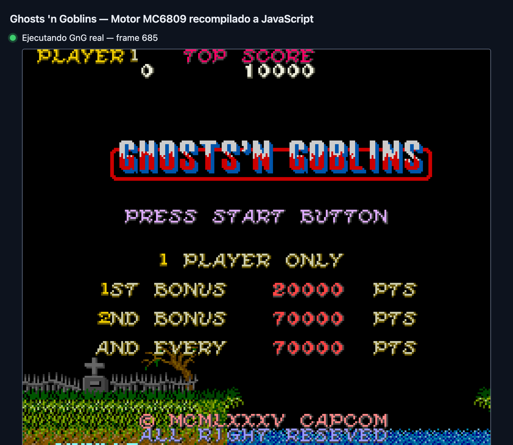
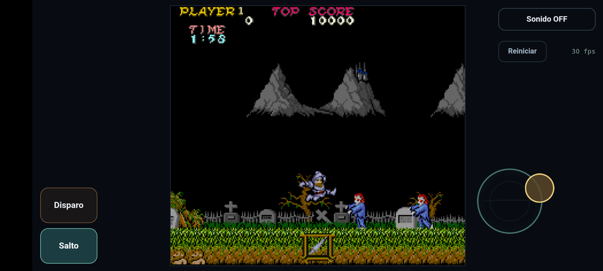

# Migrating an arcade game to JavaScript

This repository shows **a process** for bringing an arcade game to JavaScript without emulating it: the original code is translated to JS before it runs. The first case is a 1985 arcade game on a Motorola 6809 board with a Z80 sound CPU; it now runs in the browser and as an offline Android app.

<table>
<tr>
<td width="50%"></td>
<td width="50%"></td>
</tr>
<tr>
<td align="center"><sub>Web</sub></td>
<td align="center"><sub>Offline Android</sub></td>
</tr>
</table>

> Non-commercial research project. No ROM or game assets are included or provided; see the [legal notice](#legal-notice).

---

## 1. Layers

Everything that does not depend on the game lives in **rom-migration-base**, a private repository published as `v0.1.0`. This repository is its first consumer: it adds only the board, the game and the app, and uses the base as a pinned copy in `base/`.



## 2. Build: from the ROM to the APK

The MC6809 opcodes are decoded only here, offline. At runtime there is no emulator or interpreter, only compiled blocks.



```bash
bash scripts/v3_b3_local.sh            # compiled bundle in out/ (needs the ROM)
node scripts/ao_build_assets.mjs       # shared web/Android app in out/android/assets
node scripts/ao_serve.mjs              # desktop: http://127.0.0.1:18609/index.html
bash scripts/ao_build_apk.sh           # Android: APK in out/android/
```

## 3. Runtime

The same page runs in Chromium and inside the WebView of an Android app, with no server or network.



## 4. Verification: nothing moves forward without a comparison

MAME is the oracle: it is used only to compare and never ships in the product. Each piece is validated on its own; anything unknown stops the run instead of being guessed.



| Stage | Question | Proof |
|---|---|---|
| 1 · Reference | What do we compare against? | A real frame captured in MAME |
| 2 · Video | Do we draw like the arcade? | 600/600 identical frames |
| 3 · CPU | Does the translated code do the same? | 4,955 checks, no differences |
| 4 · Board | Does it run from power-on without MAME? | 594/600 exact frames |
| 5 · Controls | Is it playable? | Coin, Start and the player character, byte for byte |
| 6 · Sound | Does the original sound program play? | Output identical to the native one |
| 7 · Content | Is all the code there? | 7 stages load as in MAME (via shortcut) |
| 8 · Platforms | Does it work outside the Mac? | 600 identical frames in the browser; app with sound |

The repository name comes from the first approach, decompiling with Ghidra, which was dropped in favour of translating block by block.

**Status (31 Oct 2026):** video, controls and sound match MAME, and the Android app is playable. On web and Android you can save and load a game with exact sound (Save and Load buttons, or `G` and `C` on desktop; `T` exports the session tape). Still missing: the final signed APK. Since 4 Nov 2026 a bot also plays the game from power-on to the true ending ([§5](#5-playing-it-to-the-end-a-go-explore-bot)).

## 5. Playing it to the end: a Go-Explore bot

To check that the translated game runs all the way through, a bot plays it headless, pressing only buttons. It found one input-only tape of 96,400 frames (about 27 minutes of play) that goes from power-on through every stage of both loops to the true ending. Replaying that tape from power-on, with no saved states, reaches the ending again.

The bot uses Go-Explore ([Ecoffet et al., 2019](https://arxiv.org/abs/1901.10995)). It works like playing with save games: it saves every new place it reaches, then loads one of the places it has tried least and plays at random from there. Random play alone rarely gets far, because one attempt has to get every hard step right in a row; saving turns that product into a sum.



- A **place** is a coarse summary of the game state: stage, checkpoint, position in 16×8-pixel squares, armor and boss life.
- **Explore** means random buttons for up to 120 frames (about 2 s), stopping at the first fatal hit.
- A known place is replaced only if it was reached **better**: with less damage, or earlier.

Go-Explore opened each hard stretch; a beam search and short hand-written maneuvers finished the boss fights and the narrow passages. In total the search ran about 3.4 million rounds and 286 million game frames, in about 11 CPU hours. Commands, criteria and evidence: [docs/go-explore](docs/go-explore/README.md).

## 6. The next game

A new game does not start by copying this repository: the base generator creates a project with the pinned base, its lock and a runnable example. Reusing code does not carry over the proof: each game goes through stages 1 to 8 again against its own reference.



## Legal notice

This is a non-commercial research project on static recompilation of arcade code. It is not affiliated with, sponsored by or endorsed by the owners of the game or its trademarks; all names and marks belong to their respective owners and are used only to identify compatibility.

- No ROM images, data extracted from them or game assets are included, and none will be provided. Running the game requires a ROM you are entitled to use.
- Everything generated from the ROM (bundle, assets, APK) stays in `out/`, outside Git, and must not be redistributed.
- The screenshots above are for documentation and commentary only.
- The code written for this repository is MIT-licensed ([LICENSE](LICENSE)); the [NOTICE](NOTICE) file lists what that license does not cover.
- To request removal of any material, open an issue.

---

**Further reading (in Spanish):** [detailed architecture](docs/arquitectura-base.md) · [base ownership and provenance](docs/base-asignacion-y-procedencia.md) · [reusable base plan](docs/plan-base-reutilizable-2026-10-28.md) · [save and load](docs/checkpoint-web-2026-10-29.md) · [historical log](docs/bitacora-readme-2026-10.md)
