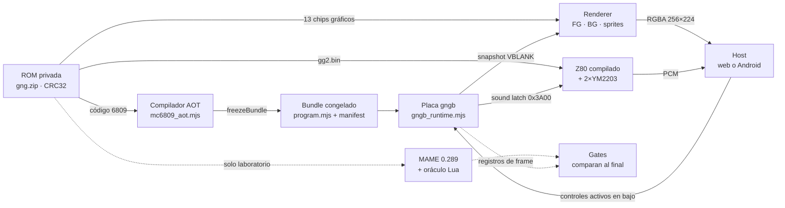
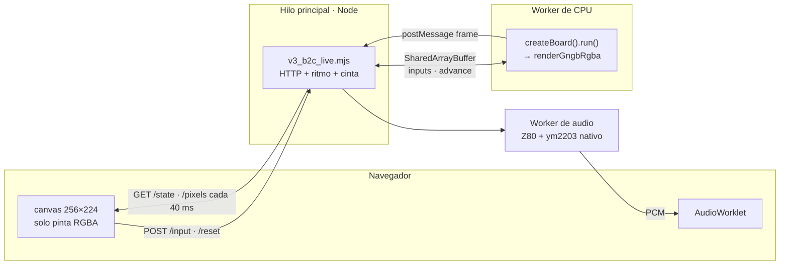
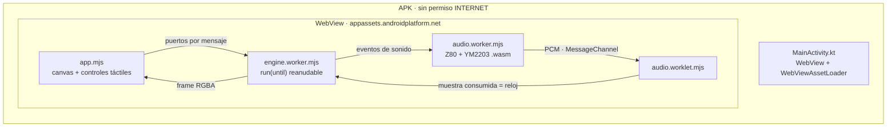
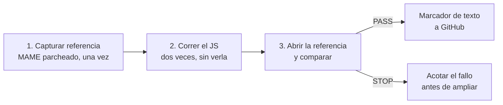
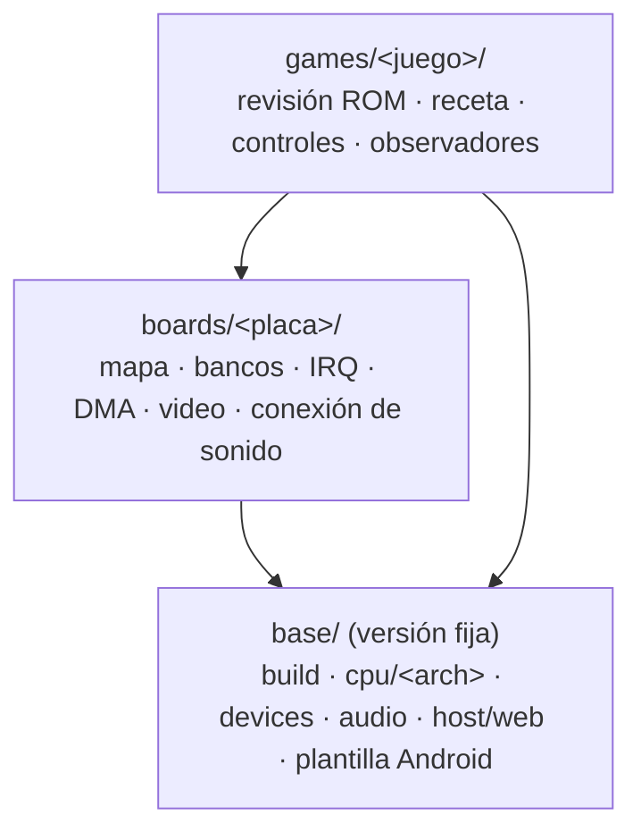

# gng-ghidra — Ghosts 'n Goblins recompilado a JavaScript

gng-ghidra toma el código MC6809 original de **Ghosts 'n Goblins** (placa `gngb`, Capcom 1985) y lo **traduce a JavaScript antes de ejecutarlo**. Al correr no hay emulador ni intérprete. Una placa modelada despacha bloques ya compilados, un renderer arma cada frame y el programa de sonido Z80 original, también compilado, mueve dos YM2203.

El mismo motor funciona de dos maneras:

- **Web:** un servidor local en el Mac y el juego en el navegador.
- **Android offline:** un APK que corre motor, video y sonido dentro del teléfono, sin red ni servidor.

MAME **no es parte del producto**. Se usa como oráculo de laboratorio: cada avance se aceptó comparándolo contra una referencia nativa, y esa referencia nunca entra al runtime.

Este README explica la base, las dos modalidades y el proceso que nos trajo hasta acá. El proceso es lo que queremos convertir en un **esqueleto reutilizable para migrar otros juegos**.

> **La ROM no está en el repositorio.** Todo lo que se deriva de ella (bundles, assets, capturas, APK) se genera en la máquina del operador, dentro de `out/`, que Git ignora. En GitHub solo hay código, tests sin ROM, documentación y marcadores de texto como `PASS` o `BLOCKED`.

| Estado al 28/10/2026 · `main` @ `8891147` | |
|---|---|
| Primer frame autónomo certificado (V2) | ✅ 290 frames idénticos píxel a píxel a MAME |
| Crédito, Start y Arthur controlable (H1) | ✅ byte a byte igual a MAME en 9 cintas |
| Sonido en vivo: Z80 + 2×YM2203 (G5) | ✅ |
| Contenido: fases, jefes, vueltas y final (H3–H4) | 🟡 las 7 fases corren igual que MAME; falta cerrar la fase 1 tras el cíclope |
| Android offline con sonido y joystick (AO) | 🟡 APK 0.6.3 jugable; falta el APK final firmado y la medida por ADB |
| Base reutilizable para otros juegos (RP) | ⚪ planificada ([plan](docs/plan-base-reutilizable-2026-10-28.md)) |

---

## 1. La idea: recompilar, no emular

Un emulador lee cada opcode en tiempo de ejecución y decide qué hacer. Acá ese trabajo se hace **una sola vez, en build**:

1. Un compilador AOT recorre el código desde los vectores RESET e IRQ y genera **una función JavaScript por bloque básico**. Respeta la semántica y el orden de bus de MAME 0.289.
2. El resultado se **congela** en un bundle inmutable con un manifiesto SHA-256.
3. En ejecución, la placa solo busca el bloque `(banco, PC)` y lo ejecuta. Si el bloque no existe, **se detiene** (`UNCOMPILED`) en lugar de improvisar.



La línea punteada es el laboratorio: MAME captura una referencia, el JS corre sin verla y recién al final los gates comparan las dos cosas.

### Principios que sostienen todo

- **Falla en cerrado.** Un valor desconocido (registro, RAM o banco), un opcode no documentado o código en RAM que no coincide con la ROM detienen la placa con un motivo. Nunca se asume cero.
- **Lo desconocido se informa como desconocido.** Los frames 1–310 quedan sin certificación visual porque alguna entrada del renderer sigue desconocida, y así figuran.
- **Bundles inmutables por generación.** Cada generación (B2D, g1…g6) se certifica contra la anterior y ninguna modifica a otra.
- **El oráculo nunca está en el runtime.** MAME se usa para comparar, no para ejecutar.
- **Frontera privada.** La ROM y sus derivados no salen de la máquina del operador.

---

## 2. La base común

### Componentes

| Capa | Archivos | Responsabilidad |
|---|---|---|
| Compilación 6809 | [mc6809_aot.mjs](src/mc6809_aot.mjs), [mc6809_aot_lib.mjs](src/mc6809_aot_lib.mjs) | Descubre bloques y genera JS, con ALU y máscaras de valores conocidos |
| Descubrimiento | [v3_b3_static_closure.mjs](src/v3_b3_static_closure.mjs), [v3_b3_jump_tables.mjs](src/v3_b3_jump_tables.mjs), [v3_b3_ondemand.mjs](src/v3_b3_ondemand.mjs) | Cierre estático de la ROM, tablas de salto y semillas desde cintas |
| Congelado | [v2_b1_frozen.mjs](src/v2_b1_frozen.mjs) | Bundle inmutable con hashes y rechazo de corrupción |
| Placa | [gngb_runtime.mjs](src/gngb_runtime.mjs), [gngb_block_key.mjs](src/gngb_block_key.mjs) | Mapa `gng_main_map`, bancos, IRQ de VBLANK, DMA de sprites, latch y snapshots |
| Video | [gngb_frame_renderer.mjs](src/gngb_frame_renderer.mjs), [video_memory.mjs](src/video_memory.mjs), [sprite_memory.mjs](src/sprite_memory.mjs) | Compone FG, BG y sprites con prioridad y genera RGBA de 256×224 |
| Sonido | [gngb_z80_live_session.mjs](src/gngb_z80_live_session.mjs), [gngb_z80_sound_bus.mjs](src/gngb_z80_sound_bus.mjs), [ao_ym2203_wasm.cpp](src/ao_ym2203_wasm.cpp) | Z80 compilado ejecuta `gg2.bin`, dos YM2203 (ymfm) producen PCM |
| Transporte de audio | [gngb_audio_resampler.mjs](src/gngb_audio_resampler.mjs), [gngb_audio_pcm_queue.mjs](src/gngb_audio_pcm_queue.mjs) | Cola PCM y remuestreo a la frecuencia de la tarjeta de sonido |
| Entradas | [gngb_input_contract.mjs](src/gngb_input_contract.mjs) | Acciones del jugador traducidas a bits activos en bajo en `0x3000–0x3002` |

### La placa en una tabla

`gngb_runtime.mjs` reproduce el `gng_main_map` de MAME 0.289. Esto es todo lo que la CPU puede tocar:

| Dirección | Qué es |
|---|---|
| `0x0000–0x1DFF` | RAM de trabajo (lo que nunca se escribió es desconocido) |
| `0x1E00–0x1FFF` | Sprite RAM, 128 × 4 bytes |
| `0x2000–0x27FF` / `0x2800–0x2FFF` | VRAM FG (tiles 8×8) / VRAM BG (tiles 16×16) |
| `0x3000–0x3004` | Entradas activas en bajo; DIP fijos en `0xDF` y `0xFB` |
| `0x3800–0x39FF` | Paleta RGBx_444 |
| `0x3A00` | Sound latch hacia el Z80 |
| `0x3B08–0x3B0B` | Scroll del BG |
| `0x3C00` | Escribir acá copia la sprite RAM al buffer del renderer (DMA) |
| `0x3D00–0x3D07` | Latch LS259 (flip) |
| `0x3E00` | Selector de banco |
| `0x4000–0x5FFF` | ROM con banco (5 bancos de 8 KiB) |
| `0x6000–0xFFFF` | ROM fija y vectores |

Cada frame dura 25.152 ciclos a 1,5 MHz (16,768 ms). La IRQ de VBLANK entra una vez por frame y queda retenida hasta el ACK.

### Generaciones del bundle

El descubrimiento de código fue el problema central. Esta tabla muestra cómo evolucionó:

| Generación | Cómo se amplió | Tamaño | Qué desbloqueó |
|---|---|---|---|
| R3.5 T5 | Bucle `UNCOMPILED` → semilla, 32 iteraciones | 354 bloques | 600 frames continuos desde reset |
| V3.B2D | Rutas tardías de Coin y Start | 1.654 bloques | 3 perfiles de 1.500 frames |
| B3 g1–g2 | Descubrimiento de una pasada desde cintas | 2.266 bloques | Crédito, Start y Arthur controlable |
| B3 g3 | Bloques multi-entrada (el IRQ vuelve a mitad de bloque) | 8.287 entradas | 24.000 frames en vivo |
| B3 g5 | Cierre estático de toda la ROM | 37.977 entradas | Ningún HALT histórico queda sin cubrir |
| **B3 g6 (vigente)** | El cierre salta punteros nulos en tablas | 38.084 entradas · 27 MB | Las 7 fases cargan y corren igual que MAME |

La lección: el bucle "falla, agrego la semilla, recompilo" sirve para arrancar, pero agrega 1–3 bloques por vuelta. Lo que escaló fue el **análisis estático**: inmediatos `LDX/LDY/LDU/LDD #` como semillas y tablas de punteros en los 5 bancos.

---

## 3. Modalidad web

```bash
node scripts/v3_b2c_live.mjs --serve
# abrir http://127.0.0.1:18609  (solo loopback)
```



- La CPU corre en un worker. Después de cada frame espera en `Atomics.wait` hasta que el hilo principal la libera, al menos 17 ms después. Eso fija un ritmo cercano a 60 Hz.
- El navegador no calcula nada: pide el último frame y lo pinta. `/state` incluye `busWitness`, con las lecturas reales que la CPU hizo en `0x3000–0x3001`, su ciclo y su PC.
- La sesión se pausa en el primer VBLANK visible (frame 311) hasta que se inserta una moneda o se elige continuar sin moneda.
- Cada sesión graba una **cinta de puertos** en `out/v3/b3/live-tapes`. [v3_b3_live_replay.mjs](scripts/v3_b3_live_replay.mjs) la reproduce offline y llega al mismo hash de frame.
- Un HALT `UNCOMPILED` muestra el banco y el PC que faltan.

| Control | Tecla |
|---|---|
| Moneda (100 ms apretada, 200 ms suelta; los clicks se encolan) | `5` |
| Start 1P | `1` |
| Joystick 4 direcciones | flechas |
| Ataque · salto | `Z` · `X` |
| Activar audio (el navegador exige un gesto) | botón |
| Reiniciar desde reset en frío | botón |

> Por qué 100 ms: medimos que la ROM acredita la moneda solo si la CPU la lee activa en 12 frames o menos. Con 200 ms caía en 12 o 13 lecturas según la fase y a veces no entraba ([df13b38](https://github.com/krukmat/gng-ghidra/commit/df13b38)).

---

## 4. Modalidad Android offline

El objetivo es un APK privado que corra en el teléfono el motor g6, el video y el sonido, **sin Mac, sin servidor y sin red**. El plan completo está en [plan-android-offline-2026-10-28.md](docs/plan-android-offline-2026-10-28.md).



Qué cambia respecto de la web:

| Tema | Web | Android |
|---|---|---|
| Host | Node + navegador en el Mac | Shell Kotlin con WebView, todo local |
| Ritmo de la CPU | `Atomics.wait` sobre `SharedArrayBuffer` | `run(until)` reanudable por frame, sin `SharedArrayBuffer` (una WebView sin aislamiento de origen no lo garantiza) |
| YM2203 | Proceso nativo (ymfm) por stdin/stdout | ymfm compilado a un `.wasm` de 32 KB, **PCM idéntico byte a byte** al nativo |
| Reloj maestro | Temporizador del hilo principal | La muestra de audio que el altavoz ya consumió, con 8 frames (134 ms) de adelanto |
| Underrun | STOP (política G5) | Con sonido ON abre una sesión nueva, máximo 5 por minuto |
| Controles | Teclado y botones | Disparo y Salto abajo a la izquierda; joystick flotante abajo a la derecha con diagonales de salto ([ao_stick.mjs](src/ao_stick.mjs)) |
| Pantalla | 25 fps de polling | CPU siempre a ritmo real; el render baja a 30 fps si no llega a 60 |

El runtime reanudable ([ao_resumable_runtime.mjs](src/ao_resumable_runtime.mjs)) es una **copia derivada** del runtime certificado y no lo modifica. Se probó con 600 llamadas `run(k)` contra un solo `run()`: hashes de frame, eventos de audio y ciclo final idénticos.

### Construir e instalar

Requisitos en el Mac: Android SDK, OpenJDK 17 y emsdk 4.0.15 (el wrapper de Gradle se descarga solo). Hace falta además la ROM en `roms/gng.zip` y el bundle g6 ya generado en `out/`.

```bash
bash scripts/ao_build_apk.sh       # WASM de audio + assets privados + assembleDebug
# → out/android/gng.apk (≈3,4 MB, privado: no se publica ni se comparte)
adb install -r out/android/gng.apk
```

`ao_build_apk.sh` encadena [ao_build_audio_wasm.sh](scripts/ao_build_audio_wasm.sh), [ao_build_assets.mjs](scripts/ao_build_assets.mjs) y Gradle.

### Verificaciones sin pantalla (Playwright, headless)

| Comando | Qué comprueba |
|---|---|
| `node scripts/ao_browser_check.mjs` | Motor en Chromium headless: los primeros 600 frames RGBA idénticos a Node, 120 s a ritmo real |
| `node scripts/ao_controls_check.mjs` | Cada toque llega a una lectura real de la CPU; Moneda + Start 5/5; `--gameover` prueba Game Over + Continuar |
| `node scripts/ao_stick_android_check.mjs` | Joystick en el emulador con toques reales del SO: `0xfe → 0xde → 0xfe → 0xff` |
| `node scripts/ao_audio_check.mjs` | Sonido ON/OFF, segundo plano y reinicio sin underruns |
| `node scripts/ao_android_check.mjs 600 <serial> --audio` | Medida automática en el teléfono por ADB (pendiente) |

Ninguna prueba roba el foco ni lee el teclado del operador. El emulador corre sin ventana y el teléfono se usa solo para medir y jugar.

---

## 5. Cómo trabajamos: el proceso de desarrollo

Esto es lo más reutilizable del proyecto, más que cualquier archivo.

### Gates: ningún avance se acepta porque "el código existe"



- Cada etapa se cierra con un **gate reproducible** con criterios GO/STOP escritos antes de empezar.
- Ante un STOP se frena, se informa y se replanifica. No se sigue gastando sobre algo que no pasó.
- **Validar cada pieza por separado primero.** El renderer se certificó con el estado capturado por MAME (600/600) antes de conectarlo a la CPU JS. El YM2203 en WASM se comparó contra el nativo antes de meterlo en el APK.
- Las **cintas de entrada** (solo inputs) son el formato de intercambio. Se pueden versionar, se reproducen en MAME y en el AOT, y permiten regresión determinista.

### Hitos recorridos

| Etapa | Qué demostró |
|---|---|
| **R0** | Frame real de MAME como referencia: PNG, VRAM, paleta, scroll y sprites |
| **R1** | Renderer JS igual a MAME con el mismo estado: 600/600 frames |
| **R2** | Oráculo de ejecución: MAME parcheado emite trazas y eventos por ciclo |
| **R3** | Recompilación 6809 → JS: 4.955 checkpoints de registros sin divergencias |
| **R3.5** | Runtime continuo desde reset: IRQ y SYNC al ciclo, 594/600 frames exactos |
| **V2 · R4** | Primer frame autónomo certificado, merge a `main` el 26/10/2026 |
| **V3 · H1–H2** | Primer control jugable: crédito, Start y Arthur idénticos a MAME; 24.000 frames en vivo sin HALT |
| **G5** | Sonido Z80 + 2×YM2203 en vivo; regresión de 161 tests de Node y 78 de Python |
| **H3** | Contenido: cierre estático, 7 fases iguales a MAME y sonda TAS desde reset hasta el cíclope |
| **AO-1…AO-6** | Android offline: runtime reanudable, WebView, controles táctiles, audio WASM y ritmo marcado por el audio |

Las pruebas pasan por los mismos caminos que usa el producto: Playwright para todo lo que toca un navegador y el emulador Android sin ventana con toques reales del sistema operativo.

### Lo que no funcionó (y también se documenta)

- **El pipeline con Ghidra** (P-code 6809 → IR → codegen por rutina, con un MC6809 en C++ como oráculo) fue la primera ruta. Hoy es **referencia congelada**: la recompilación directa por bloque con el orden de bus de MAME resultó más fiel y más simple. El nombre del repositorio viene de esa etapa.
- **Un collage de fixtures** (V1.2) dio una imagen ilegible y se descartó. Por eso R0 capturó un frame real primero.
- **El bot visual** quedó pausado: el contenido avanza más rápido con la sonda TAS (Go-Explore) sobre cintas.
- **Un modo LAN** para Android se empezó y se revirtió sin commit cuando se decidió ir offline.

---

## 6. Hacia un esqueleto para migrar otros juegos

La dirección vigente es **extraer de este repositorio una base agnóstica y versionada** en un repositorio aparte (nombre de trabajo `rom-migration-base`), con herramientas para generar un proyecto independiente por juego. GnG queda como **primera integración y consumidor de referencia**. El detalle está en [plan-base-reutilizable-2026-10-28.md](docs/plan-base-reutilizable-2026-10-28.md). Todavía no se extrajo nada.

### Tres capas con dependencia en un solo sentido



La base nunca importa una placa ni un juego concreto. La placa usa dispositivos compartidos y el juego compone ambos.

### Qué se reutiliza según el caso

| Nuevo proyecto | Se comparte | Hay que hacerlo de nuevo |
|---|---|---|
| Otra revisión de la misma placa | Compiladores, dispositivos, placa, host y herramientas | Identificación de ROM, generación, cobertura y validación |
| Otra placa con CPU ya soportada (6809 o Z80) | Compilador de la CPU, dispositivos coincidentes (p. ej. YM2203), host web y Android | Mapa, bancos, interrupciones, video y pruebas propias |
| Otra arquitectura de CPU | Host, contratos, empaquetado y método de validación | Compilador y ejecución de la CPU, placa y dispositivos que falten |

Compartir una CPU o un chip **no** transfiere la evidencia de GnG: cada migración se certifica con su propio oráculo.

### Contratos mínimos entre capas

| Contrato | Qué fija |
|---|---|
| Binario → regiones | Revisión, tamaños y hashes; receta de disposición explícita |
| Compilador → vista de código | Bytes e identidad del código por contexto, sin conocer puertos ni bancos del juego |
| CPU ↔ placa | Lecturas y escrituras con tiempo y máscaras conocidas; las líneas de interrupción vienen de la placa |
| Ejecución → host | Crear sesión, avanzar hasta un límite y recibir el estado de parada; reset de CPU, reset de placa y sesión nueva son cosas distintas |
| Placa → video / sonido | Frame con geometría y secuencia; PCM con frecuencia, posición de muestra y sesión |
| Usuario → juego → placa | Acciones lógicas traducidas a hardware; DIP y secuencias especiales fuera del host común |
| Oráculo → comparador | Evidencia atada a binario, herramientas, escenario y ámbito; un PASS no se transfiere sin validar |

### Estructura de un proyecto generado

```text
proyecto-nuevo/
  base/                  copia versionada de componentes de rom-migration-base
  boards/<placa>/        bus, mapas, bancos, dispositivos y señales
  games/<juego>/         revisión ROM, receta, controles y observadores
  tools/  tests/
  android/               opcional, generado desde la plantilla
  roms/  out/            privados, ignorados por Git
  migration.json         selección y configuración
  migration.lock.json    revisión exacta y hashes de la base
```

### Receta para migrar un juego (con lo aprendido acá)

1. **Fijar la ROM.** Identificar la revisión por los CRC de los chips, no por el nombre del ZIP.
2. **Capturar un frame real** del oráculo (estado de video y PNG) antes de escribir código de producto.
3. **Certificar el renderer** alimentándolo con el estado capturado.
4. **Modelar la placa** a partir del mapa de memoria del driver de referencia.
5. **Compilar desde los vectores** y cerrar estáticamente el código alcanzable. Usar el bucle `UNCOMPILED` → semilla solo como red de seguridad.
6. **Correr desde reset** sin estado inyectado y comparar estado y eventos por frame.
7. **Abrir los controles** con cintas de entrada reproducibles en el oráculo y en el AOT.
8. **Agregar el sonido** con el programa original del chip de audio y validar el PCM por separado.
9. **Empaquetar** para web y, si hace falta, para Android desde la plantilla.

Las tareas de extracción son RP-0 (fijar la referencia) a RP-6 (certificar y versionar la base), cada una con su GO.

---

## 7. Estructura del repositorio

| Carpeta | Contenido |
|---|---|
| [src/](src/) | Compilador AOT, placa, renderer, sonido, contratos y piezas `ao_*` de Android |
| [scripts/](scripts/) | Builds, gates, motor en vivo, exploración H3, audio y verificaciones `ao_*` |
| [tests/](tests/) | Unos 190 archivos; la regresión no necesita la ROM |
| [android/](android/) | Proyecto Gradle, `MainActivity.kt` y el host web de la WebView en `android/web/` |
| [docs/](docs/) | Planes, auditorías, checkpoints y marcadores |
| `ghidra_scripts/`, `patches/`, `docker/` | Pipeline Ghidra congelado, parches de MAME para el oráculo, entornos de laboratorio |
| `roms/`, `out/` | Privados e ignorados por Git |

### Requisitos

- **Producto (web):** Node.js con ES modules y `worker_threads`, la ROM en `roms/gng.zip` y un bundle certificado en `out/`.
- **Android:** Android SDK, OpenJDK 17 y emsdk 4.0.15.
- **Pruebas de navegador:** `npm install` (instala solo `playwright-core`).
- **Laboratorio:** MAME 0.289 con los parches de [patches/](patches/) y Python 3. Solo hace falta para capturar referencias, no para jugar.

## 8. Documentación

- [Arquitectura con diagramas](https://claude.ai/artifact/49wcCwm3emRLjxMCx6vnAx), la fuente de este README
- [docs/architecture.md](docs/architecture.md) · [docs/roadmap.md](docs/roadmap.md)
- [Plan Android offline](docs/plan-android-offline-2026-10-28.md)
- [Plan de base reutilizable](docs/plan-base-reutilizable-2026-10-28.md)
- [Plan 100 % jugable](docs/plan-100pct-jugable-2026-10-26.md) · [Contenido H3–H4](docs/plan-contenido-h3-h4-2026-10-27.md)
- [Oráculo de frame (R0)](docs/frame-oracle.md) · [Plan de ejecución R0–R6](docs/plan-ejecucion.md)
- [Bitácora del README anterior](docs/bitacora-readme-2026-10.md): instrucciones operativas históricas, R0–V3
- [Issues](https://github.com/krukmat/gng-ghidra/issues)
