# gng-ghidra: migrating an arcade game to JavaScript

This repository shows **a process** for bringing an arcade game to JavaScript without emulating it: the original code is translated to JS before it runs. The first case is **Ghosts 'n Goblins** (Capcom, 1985), which now runs in the browser and as an offline Android app.

<table>
<tr>
<td width="50%"></td>
<td width="50%"></td>
</tr>
<tr>
<td align="center"><sub>Web</sub></td>
<td align="center"><sub>Offline Android</sub></td>
</tr>
</table>

> The ROM is not included. Everything derived from it stays in `out/`, outside Git; these screenshots are the only exception. Not affiliated with Capcom.

---

## 1. Layers

Everything that does not depend on the game lives in **rom-migration-base**, a private repository published as `v0.1.0`. gng-ghidra is its first consumer: it adds only the board, the game and the app, and uses the base as a pinned copy in `base/`.



## 2. Build: from the ROM to the APK

The MC6809 opcodes are decoded only here, offline. At runtime there is no emulator or interpreter, only compiled blocks.



```bash
bash scripts/v3_b3_local.sh            # compiled bundle in out/ (needs the ROM)
node scripts/ao_build_assets.mjs       # shared web/Android app in out/android/assets
node scripts/ao_serve.mjs              # desktop: http://127.0.0.1:18609/index.html
bash scripts/ao_build_apk.sh           # Android: out/android/gng.apk
```

## 3. Runtime

The same page runs in Chromium and inside the WebView of an Android app, with no server or network.



## 4. Verification: nothing moves forward without a comparison

MAME is the oracle: it is used only to compare and never ships in the product. Each piece is validated on its own; anything unknown stops the run instead of being guessed.



| Stage | Question | Proof |
|---|---|---|
| 1 · Reference | What do we compare against? | A real frame captured in MAME |
| 2 · Video | Do we draw like the arcade? | 600/600 identical frames |
| 3 · CPU | Does the translated code do the same? | 4,955 checks, no differences |
| 4 · Board | Does it run from power-on without MAME? | 594/600 exact frames |
| 5 · Controls | Is it playable? | Coin, Start and Arthur, byte for byte |
| 6 · Sound | Does the original sound program play? | Output identical to the native one |
| 7 · Content | Is all the code there? | 7 stages load as in MAME (via shortcut) |
| 8 · Platforms | Does it work outside the Mac? | 600 identical frames in the browser; app with sound |

The repository name comes from the first approach, decompiling with Ghidra, which was dropped in favour of translating block by block.

**Status (31 Oct 2026):** video, controls and sound match MAME, and the Android app is playable. On web and Android you can save and load a game with exact sound (Save and Load buttons, or `G` and `C` on desktop; `T` exports the session tape). Still missing: a full playthrough from start to finish and the final signed APK.

## 5. The next game

A new game does not start by copying gng-ghidra: the base generator creates a project with the pinned base, its lock and a runnable example. Reusing code does not carry over the proof: each game goes through stages 1 to 8 again against its own reference.



---

**Further reading (in Spanish):** [detailed architecture](docs/arquitectura-base.md) · [base ownership and provenance](docs/base-asignacion-y-procedencia.md) · [reusable base plan](docs/plan-base-reutilizable-2026-10-28.md) · [save and load](docs/checkpoint-web-2026-10-29.md) · [historical log](docs/bitacora-readme-2026-10.md) · [issues](https://github.com/krukmat/gng-ghidra/issues)
