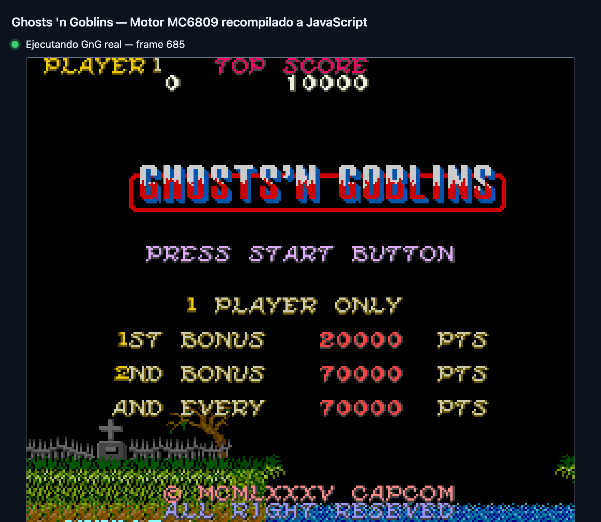
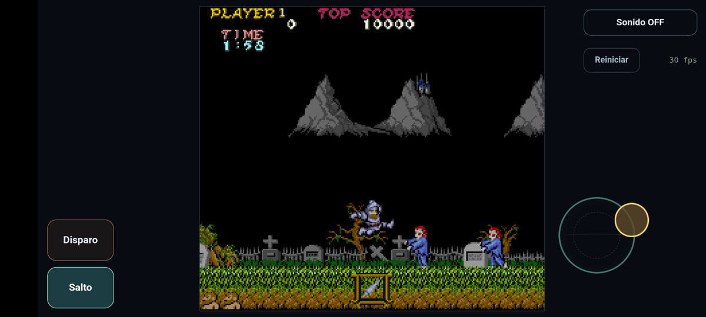
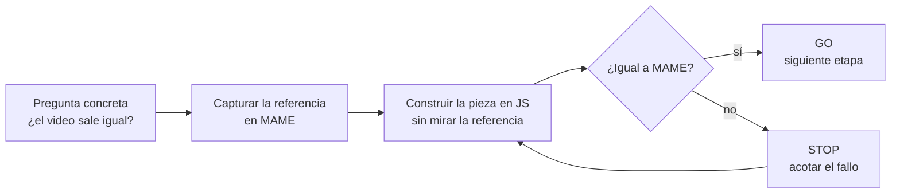
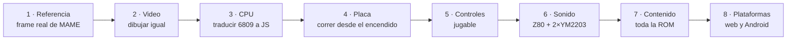
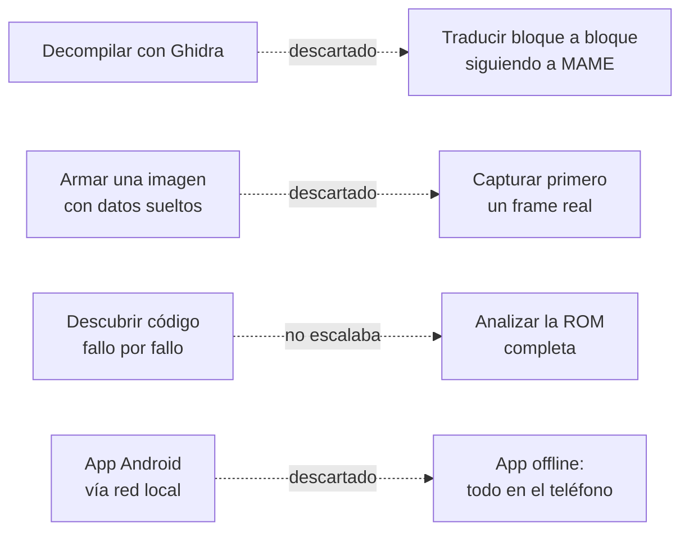
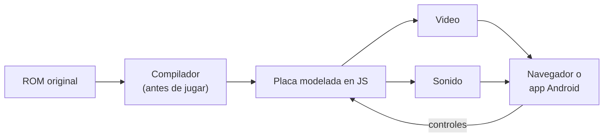
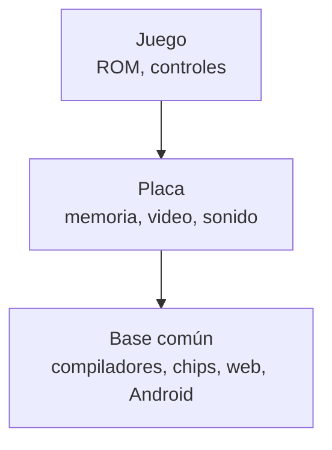

# gng-ghidra — Cómo migramos un arcade a JavaScript

Este repositorio documenta **un proceso** para llevar un juego arcade a JavaScript sin emularlo: el código original se traduce a JS antes de ejecutarse. El primer caso es **Ghosts 'n Goblins** (Capcom, 1985). Hoy corre en el navegador y como app Android offline.

Lo que buscamos reutilizar es el proceso: el producto es su primer resultado.

<table>
<tr>
<td width="50%"></td>
<td width="50%"></td>
</tr>
<tr>
<td align="center"><sub>Web</sub></td>
<td align="center"><sub>Android offline</sub></td>
</tr>
</table>

> La ROM no se incluye. Todo lo que se genera a partir de ella queda en `out/`, fuera de Git; estas capturas son la única excepción. Sin afiliación con Capcom.

---

## 1. La regla: nada avanza sin comparar

Cada etapa repitió el mismo ciclo. MAME, el emulador de referencia, nunca forma parte del producto: solo sirve para comparar.



- **Una pieza por vez.** Cada parte se valida sola antes de conectarla con las demás.
- **Lo desconocido no se inventa.** Si falta un dato o un tramo de código, el sistema se detiene y lo informa.
- **Las cintas de entrada son el idioma común.** Una cinta guarda solo las teclas pulsadas; se reproduce igual en MAME y en JS.

---

## 2. Cómo se llegó al producto

Cada etapa respondió una sola pregunta y dejó una prueba reproducible.



| Etapa | Pregunta | Cómo se respondió | Prueba |
|---|---|---|---|
| 1 · Referencia | ¿Contra qué comparamos? | Capturar en MAME un frame real con su memoria de video, paleta y scroll | Frame de referencia |
| 2 · Video | ¿Dibujamos igual que el arcade? | Alimentar el módulo de video JS con el estado capturado por MAME | 600/600 frames idénticos |
| 3 · CPU | ¿El código traducido hace lo mismo? | Una función JS por tramo de código, comparando registros con MAME | 4.955 controles sin diferencias |
| 4 · Placa | ¿Corre solo, sin ayuda de MAME? | Modelar memoria, bancos e interrupciones y arrancar desde el encendido | 594/600 frames exactos |
| 5 · Controles | ¿Se puede jugar? | Cintas de entrada reproducidas en MAME y en JS | Moneda, Start y Arthur, byte a byte |
| 6 · Sonido | ¿Suena el programa original? | Traducir también el procesador de sonido y sintetizar los chips | Salida idéntica a la nativa |
| 7 · Contenido | ¿Está todo el código? | Analizar la ROM completa en vez de descubrir código jugando | 7 fases cargan igual que en MAME (por atajo) |
| 8 · Plataformas | ¿Funciona fuera del Mac? | Mismo motor en el navegador y dentro de una app Android sin red | 600 frames idénticos en el navegador; app con sonido |

### Lo que cambió en el camino



Los callejones sin salida también son parte del método: cada uno dejó una regla. El nombre del repositorio viene del primero.

---

## 3. El resultado



```bash
bash scripts/v3_b3_local.sh            # genera el paquete compilado en out/ (requiere la ROM)
node scripts/v3_b2c_live.mjs --serve   # web: http://127.0.0.1:18609
bash scripts/ao_build_apk.sh           # Android: out/android/gng.apk
```

**Estado (28/10/2026):** video, controles y sonido iguales a MAME; app Android jugable. Falta recorrer el juego completo de principio a fin y el APK final firmado. Detalle técnico en [docs/arquitectura-base.md](docs/arquitectura-base.md).

---

## 4. El próximo juego

El objetivo es extraer de aquí una base reutilizable y repetir las mismas etapas con otro juego.



| Si el juego nuevo usa… | Se reutiliza | Hay que hacer |
|---|---|---|
| La misma placa | Casi todo | Identificar la ROM y validar |
| Otra placa, misma CPU | Compilador, chips de sonido, web y Android | Modelar la placa y validar |
| Otra CPU | Web, Android y el método | Compilador nuevo, placa y validación |

El requisito previo es tener un emulador de referencia para esa placa. Reutilizar código no transfiere las pruebas: cada juego vuelve a recorrer las etapas 1 a 8 contra su propia referencia.

---

**Más lectura:** [arquitectura detallada](docs/arquitectura-base.md) · [plan Android](docs/plan-android-offline-2026-10-28.md) · [plan 100 % jugable](docs/plan-100pct-jugable-2026-10-26.md) · [bitácora histórica](docs/bitacora-readme-2026-10.md) · [issues](https://github.com/krukmat/gng-ghidra/issues)
