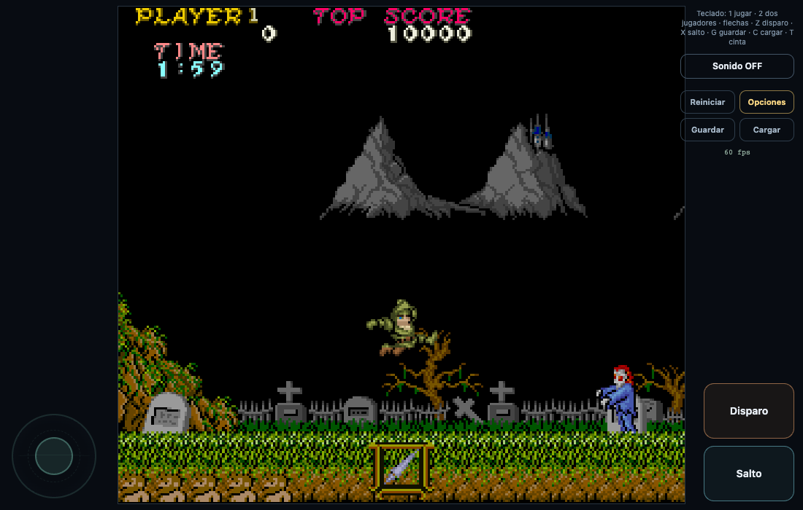
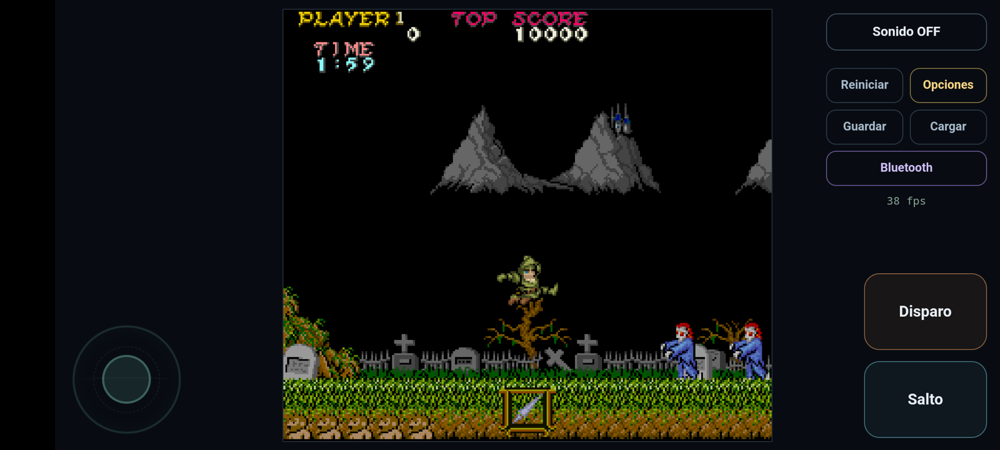
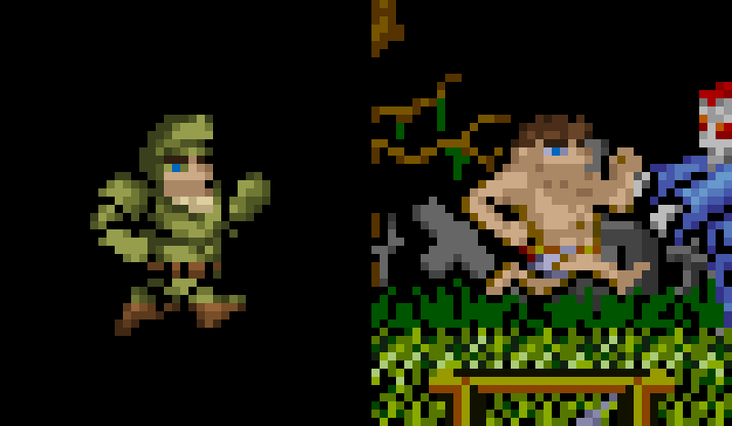

# Migrating an arcade game to JavaScript

This repository shows **a process** for bringing an arcade game to JavaScript without emulating it: the original code is translated to JS before it runs. The first case is a 1985 arcade game on a Motorola 6809 board with a Z80 sound CPU; it now runs in the browser and as an offline Android app. Players can choose Arthur or Lancelot when starting a game.

<table>
<tr>
<td width="50%"></td>
<td width="50%"></td>
</tr>
<tr>
<td align="center"><sub>Web</sub></td>
<td align="center"><sub>Offline Android</sub></td>
</tr>
</table>

<p align="center"><br><sub>Lancelot at 9× (web canvas pixels): archer outfit while protected, his own face and hair after losing protection.</sub></p>

> Non-commercial research project. No ROM or game assets are included or provided; see the [legal notice](#legal-notice).

---

## 1. Layers

Everything that does not depend on the game lives in **rom-migration-base**, a private repository published as `v0.1.0`. This repository is its first consumer: it adds only the board, the game and the app, and uses the base as a pinned copy in `base/`.



## 2. Build: from the ROM to the APK

The MC6809 opcodes are decoded only here, offline. At runtime there is no emulator or interpreter, only compiled blocks.



```bash
bash scripts/v3_b3_local.sh            # compiled bundle in out/ (needs the ROM)
node scripts/ao_build_assets.mjs       # shared web/Android app in out/android/assets
node scripts/ao_serve.mjs              # desktop: http://127.0.0.1:18609/index.html
bash scripts/ao_build_apk.sh           # Android: APK in out/android/
```

## 3. Runtime

The same page runs in Chromium and inside the WebView of an Android app, with no server or network.



New local games start with Very easy, 7 lives, By turns, sustained fire enabled and Arthur selected. Preferences survive reopening and migrate from previous app versions. The app saves living local progress when play starts, every 30 seconds of active foreground play, and attempts another save when sent to the background. When lives remain, a death restores the last confirmed automatic checkpoint with one fewer life for that player, preserving score and progress before a two-player turn can continue. Repeated deaths spend further lives, including after restarting the app. The last life follows the game-over flow. Recovery keeps the checkpoint position until another periodic save; death animations cannot replace it. Save keeps an independent manual copy. Load restores whichever copy was saved most recently, falling back to the other if it is damaged. Both automatic and manual loads restore the player's protection if it was missing. If automatic recovery fails, the app reports it once and leaves Load available. Bluetooth keeps its original life and turn rules.

Game options (difficulty, lives per game and character) apply on restart. Jugar is free: the app supplies the required credits internally and waits for the game to accept them before starting; there is no coin button or coin key. Keyboard 1 starts a new game, and 2 starts two players. In local play, losing a life restores the automatic checkpoint's progress while spending that life; repeated deaths and a restart keep the reduced count. Over Bluetooth, lives are played consecutively and the last life ends the game without a Continue countdown. Each player in a two-player game has their own starting lives. One difficulty selector combines the original DIP setting with enemy pace: Very easy = Easy / 50%, Easy = Easy / 75%, Normal = Normal / 100%, Hard = Hard / 100%, and Very hard = Hardest / 100%. The character keeps Arthur's movement, attacks and rules. Saved games and replays retain their exact original options, including the original Continue rules in older saves. Two players alternate on the same controls, as on the upright cabinet. On Android, two phones paired in the Bluetooth settings play one game by turns over a secure RFCOMM link: the phone whose player has the turn sends its inputs frame by frame, the other replays them at the same CPU cycles, and both compare a RAM hash every second. Once both players run out of lives, the match ends. The Two players option of the game options chooses how they play: By turns, each player has their own game and the higher score wins; in Cooperative, both advance one shared game: when the turn changes, the entering player resumes where the other one got to (same stage, checkpoint and weapon) with their own lives and score, and the result is the team's total. Cooperative works the same on one device and over Bluetooth, where both phones must run this version (`gng.netplay.v3`).

### Arthur and Lancelot

Choose **Personaje: Arthur / Lancelot** in Options, then start a new game. Arthur remains the default. Lancelot uses Arthur's movement, attacks and game rules, with an archer outfit while protected and his own face and hair after losing protection. Some glove pixels remain olive green. One character is selected for the whole game, including both players in By turns or Cooperative mode. In Bluetooth play the host chooses; the guest displays the same character. Older guests using `gng.netplay.v2` are rejected before play begins. Saves and exported tapes retain the chosen character; older saves and tapes without a character field use Arthur. The fixed true-ending cutscene still uses the original ROM character art.

The [Lancelot plan and results](docs/plan-lancelot-2026-11-20.md) record checks in Chromium and an Android emulator WebView: character selection, loss of protection, save/load, an online guest and rejection of an older guest, and export/replay of a Lancelot tape. A separate check replays the Go-Explore route's 96,400 input frames with Lancelot and renders 28 selected frames from all seven stages in both loops and from the false and true endings on both pages. The corresponding web and Android images have identical pixel hashes. The full route replay runs in Node with the APK's program; the browser and WebView render its selected frames with their shipped renderer.

### Two players: by turns, cooperative and over Bluetooth

The ROM keeps the playing player's block at `0x60`–`0x8F` and the waiting player's copy at `0x440`–`0x46F`, and swaps them in the routine at `0x77EC` when a player dies (the turn is RAM `0x27`). By turns is the original game, unchanged. Cooperative wraps that routine: just before the swap it copies the leaving player's block to the waiting one, except lives (`+0x00`), extra-life bookkeeping (`+0x02`–`+0x07`) and score (`+0x08`–`+0x0B`). So the entering player restarts from the last checkpoint the other player reached, at the same stage and with the same weapon, which is where the player who died would have respawned. The rule depends only on RAM, so tapes, saved games and the Bluetooth lockstep stay exact.

Over Bluetooth both phones run the whole board from reset with the same options ([src/netplay_turns.mjs](src/netplay_turns.mjs)). The phone whose player has the turn sends the port changes it read each frame (port, cycle, value); the other reads the same values at the same cycles and does not run a frame it has not received. Both derive the next frame's owner from RAM ([games/gngb/netplay.mjs](games/gngb/netplay.mjs)), so the turn passes at the same frame on both without an extra message, and an FNV-1a hash of work RAM is compared every 60 frames; a mismatch ends the session.

Private checks on the shipped program bundle (they need the ROM-derived bundle in `out/`):

| Script | What it shows |
|---|---|
| [scripts/gng_coop_check.mjs](scripts/gng_coop_check.mjs) | The same game played cooperative and by turns: in cooperative P2 enters past P1's checkpoint with P1's progress and its own lives and score; by turns P2 starts the stage again. The cooperative session replays from its tape to the same CPU state. |
| [scripts/gng_netplay_check.mjs](scripts/gng_netplay_check.mjs) `--coop` | Two boards joined by a simulated link with jitter and an outage end in the same state as one board replaying the session tape from reset. |
| [scripts/ao_coop_check.mjs](scripts/ao_coop_check.mjs) | The cooperative options dialog and automatic recovery after a real death in headless Chromium. |
| [scripts/ao_life_recovery_check.mjs](scripts/ao_life_recovery_check.mjs) | Real deaths restore automatic checkpoints in single-player, by turns and cooperative play; `--android` runs the same checks in an isolated WebView. |
| [scripts/lancelot_page_check.mjs](scripts/lancelot_page_check.mjs) `--android` | Character selection, protection loss and save/load in Chromium or an Android emulator WebView; tape export in Chromium. |
| [scripts/lancelot_online_check.mjs](scripts/lancelot_online_check.mjs) | The guest sees the host's Lancelot selection; a guest using the previous protocol is rejected. Uses a simulated Bluetooth line bridge. |
| [scripts/lancelot_tape_check.mjs](scripts/lancelot_tape_check.mjs) | An exported Lancelot tape replays from reset with the same character and final frame hash. |
| [scripts/lancelot_route_check.mjs](scripts/lancelot_route_check.mjs) | The Go-Explore tape covers both loops and both endings with Lancelot; 28 selected frames render identically in Chromium and the Android WebView. |
| [scripts/gng_coop_video.mjs](scripts/gng_coop_video.mjs) | Side-by-side video of the same game cooperative and by turns. |
| [scripts/gng_coop_netplay_video.mjs](scripts/gng_coop_netplay_video.mjs) | Video of two linked boards, each under a strip with its phone, whether it plays or watches, its player's score and the checkpoint on screen. P1 passes the first checkpoint before dying, and P2 enters there at every turn; in the recorded run both players scored (1,700 and 900) over five turn changes. |

Not yet done: a test on two real phones with an APK that includes the cooperative option.

## 4. Verification: nothing moves forward without a comparison

MAME is the oracle: it is used only to compare and never ships in the product. Each piece is validated on its own; anything unknown stops the run instead of being guessed.



| Stage | Question | Proof |
|---|---|---|
| 1 · Reference | What do we compare against? | A real frame captured in MAME |
| 2 · Video | Do we draw like the arcade? | 600/600 identical frames |
| 3 · CPU | Does the translated code do the same? | 4,955 checks, no differences |
| 4 · Board | Does it run from power-on without MAME? | 594/600 exact frames |
| 5 · Controls | Is it playable? | Coin, Start and the player character, byte for byte |
| 6 · Sound | Does the original sound program play? | Output identical to the native one |
| 7 · Content | Is all the code there? | 7 stages load as in MAME (via shortcut) |
| 8 · Platforms | Does it work outside the Mac? | 600 identical frames in the browser; app with sound |

The repository name comes from the first approach, decompiling with Ghidra, which was dropped in favour of translating block by block.

**Status (20 Nov 2026):** video, controls and sound match MAME, and the Android app is playable. On web and Android you can choose Arthur or Lancelot, save and load a game with exact sound (Save and Load buttons, or `G` and `C` on desktop; `T` exports the session tape). Lancelot has been checked across both loops, including the false and true endings. Still missing: the final signed APK. Since 4 Nov 2026 a bot also plays the game from power-on to the true ending ([§5](#5-playing-it-to-the-end-a-go-explore-bot)).

## 5. Playing it to the end: a Go-Explore bot

To check that the translated game runs all the way through, a bot running without a display produced a recording of button inputs covering 96,400 frames (about 27 minutes). It starts at power-on, passes every stage in both loops, and reaches the true ending after the second loop. Replaying those inputs from power-on reaches the ending again without restoring a saved state.

To find that route, the bot used Go-Explore ([Ecoffet et al., 2019](https://arxiv.org/abs/1901.10995)). During the search, it saves each new place it reaches, restores a place it has tried relatively few times, and presses random buttons from there. Those saved states speed up the search; the final recording contains only button inputs.

For example, if five obstacles each have a one-in-ten chance of being passed, clearing all five in one attempt takes about 100,000 tries on average. Saving after each obstacle takes about 50 tries on average.



[Open the diagram at full size](docs/img/go-explore.svg).

- A **place** is a coarse summary of the game state: stage, checkpoint, position in 16×8-pixel squares, armor and boss life.
- **Explore** means random buttons for up to 120 frames (about 2 s), stopping at the first fatal hit.
- A saved place is replaced only when the bot reaches that same place with less damage or in fewer frames.

Go-Explore found routes into difficult sections; a beam search and short scripted button sequences completed boss fights and narrow passages. In total, the search ran about 3.4 million rounds and 286 million game frames in about 11 CPU hours. Commands, criteria and evidence: [docs/go-explore](docs/go-explore/README.md).

The same method now searches a cooperative two-player game ([scripts/gng_coop_explore.mjs](scripts/gng_coop_explore.mjs)). A stage only counts if both players played in it: the search cuts any branch that completes a stage before a turn change, and gives extra weight to cells where the turn has already passed. The cell key adds a time bucket while Arthur stands still during the map shown between stages; without it the search stalled there. A search can resume from an earlier tape (`COOP_FROM`), and [scripts/gng_coop_tape_check.mjs](scripts/gng_coop_tape_check.mjs) replays any tape from reset on the shipped bundle, checks the stages, the turn changes and the frames, and renders the video. Result: stage 1 completed by both players, with four turn changes, verified from reset. Stage 2 was not pursued further: after an hour the searches stalled at about 80% of the stage.

## 6. The next game

A new game does not start by copying this repository: the base generator creates a project with the pinned base, its lock and a runnable example. Reusing code does not carry over the proof: each game goes through stages 1 to 8 again against its own reference.



## Legal notice

This is a non-commercial research project on static recompilation of arcade code. It is not affiliated with, sponsored by or endorsed by the owners of the game or its trademarks; all names and marks belong to their respective owners and are used only to identify compatibility.

- No ROM images, data extracted from them or game assets are included, and none will be provided. Running the game requires a ROM you are entitled to use.
- Everything generated from the ROM (bundle, assets, APK) stays in `out/`, outside Git, and must not be redistributed.
- The screenshots above are for documentation and commentary only.
- The code written for this repository is MIT-licensed ([LICENSE](LICENSE)); the [NOTICE](NOTICE) file lists what that license does not cover.
- To request removal of any material, open an issue.

---

**Further reading (in Spanish):** [detailed architecture](docs/arquitectura-base.md) · [base ownership and provenance](docs/base-asignacion-y-procedencia.md) · [reusable base plan](docs/plan-base-reutilizable-2026-10-28.md) · [save and load](docs/checkpoint-web-2026-10-29.md) · [historical log](docs/bitacora-readme-2026-10.md)
