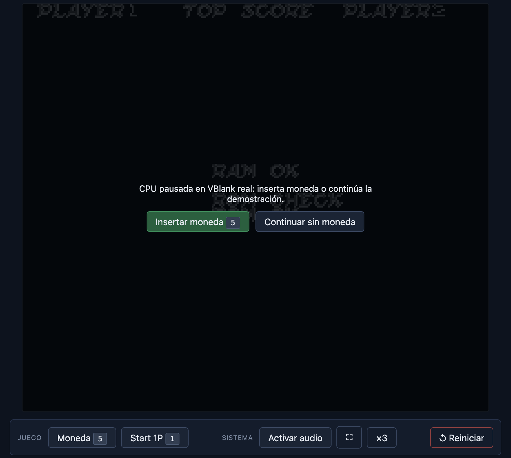
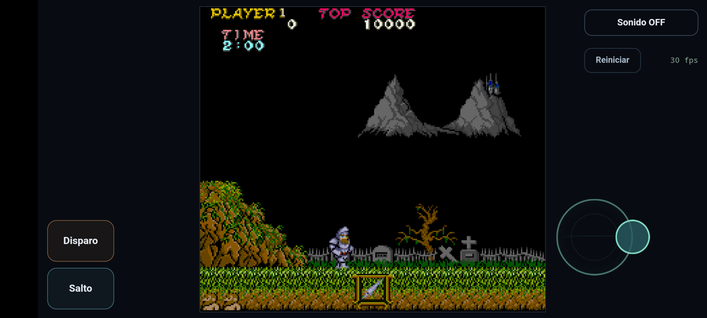
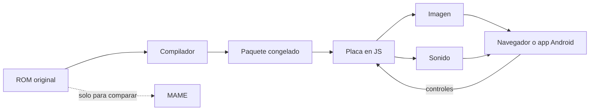
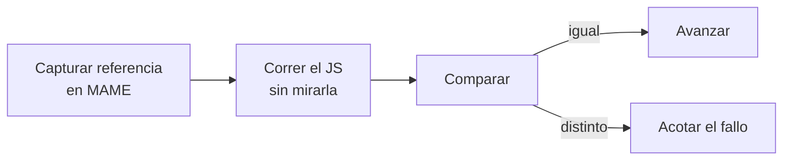
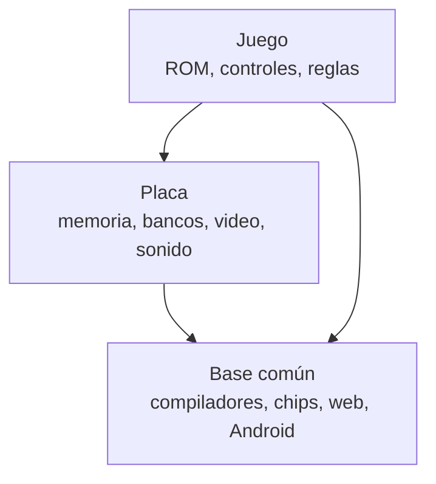

# gng-ghidra — Ghosts 'n Goblins recompilado a JavaScript

Este proyecto toma el código original de **Ghosts 'n Goblins** (arcade de Capcom, 1985) y lo **traduce a JavaScript antes de ejecutarlo**. No hay emulador: el juego corre como código JS generado a partir de la ROM, con su imagen y su sonido originales.

Funciona de dos maneras: **en el navegador** y **como app Android offline**.

<table>
<tr>
<td width="50%"></td>
<td width="50%"></td>
</tr>
<tr>
<td colspan="2" align="center"><sub><b>Web</b> · a la izquierda, la pausa en el primer frame visible; a la derecha, después de insertar una moneda</sub></td>
</tr>
<tr>
<td></td>
<td></td>
</tr>
<tr>
<td colspan="2" align="center"><sub><b>Android</b> · joystick flotante: a la derecha corre; en la diagonal superior corre y salta</sub></td>
</tr>
</table>

> **La ROM no se incluye.** Cada persona usa su propia copia, y todo lo que se genera a partir de ella (código compilado, recursos, APK) queda en `out/`, fuera de Git. Las únicas excepciones son estas cuatro capturas de presentación. Proyecto sin afiliación con Capcom.

## Estado (28/10/2026)

| Área | Estado |
|---|---|
| ✅ Imagen | El primer tramo del juego produce frames idénticos píxel a píxel a los de MAME |
| ✅ Controles | Moneda, Start y Arthur se comportan byte a byte igual que en MAME |
| ✅ Sonido | El programa de sonido original suena en vivo |
| 🟡 Contenido | El código de las 7 fases corre igual que en MAME (probado entrando por un atajo); todavía no se recorrió el juego completo de principio a fin |
| 🟡 Android | Jugable con sonido y joystick; falta el APK final firmado |
| ⚪ Base reutilizable | Planificada: extraer el esqueleto para migrar otros juegos |

---

## Cómo funciona

Un emulador lee cada instrucción del juego mientras corre. Aquí ese trabajo se hace **una sola vez, antes de jugar**:

1. **Compilar.** Un compilador recorre el código 6809 de la ROM y genera una función JavaScript por cada tramo de código sin saltos.
2. **Congelar.** Ese resultado se guarda como un paquete inmutable, verificado con hashes.
3. **Ejecutar.** Un modelo en JS de la **placa** (el hardware del arcade: memoria, bancos de ROM, interrupciones) llama a esas funciones. El módulo de video arma cada frame y el programa de sonido original, también compilado, genera el audio.



**MAME no forma parte del producto**; solo sirve de referencia para comparar (ver [Cómo trabajamos](#cómo-trabajamos)).

Si el juego llega a código que no se compiló, se detiene y avisa en lugar de inventar una respuesta. Lo mismo vale para cualquier valor desconocido: se informa, nunca se asume cero.

> **¿Por qué "ghidra"?** La primera ruta usaba Ghidra para decompilar. Quedó como referencia congelada: compilar bloque a bloque siguiendo a MAME resultó más simple y más fiel.

El detalle (componentes, mapa de memoria, evolución del compilador, contratos) está en [docs/arquitectura-base.md](docs/arquitectura-base.md).

---

## Preparar el paquete compilado

Las dos versiones necesitan la ROM en `roms/gng.zip` y el paquete compilado en `out/`. Se genera con:

```bash
bash scripts/v3_b3_local.sh   # en main y con el árbol limpio
```

Hoy ese script parte de una generación anterior ya certificada (B2-D), que se construyó en etapas previas; la [bitácora](docs/bitacora-readme-2026-10.md) registra esa cadena. Generar el paquete desde cero con un solo comando es uno de los objetivos de la base reutilizable.

## Versión web

```bash
node scripts/v3_b2c_live.mjs --serve
# abrir http://127.0.0.1:18609
```

La CPU corre en un hilo aparte de Node (un worker) y el navegador solo dibuja los frames y reproduce el sonido. El juego se pausa en el primer frame visible hasta que se inserta una moneda.

| Control | Tecla |
|---|---|
| Moneda · Start | `5` · `1` |
| Mover | flechas |
| Ataque · salto | `Z` · `X` |
| Sonido · reiniciar | botones de la página |

Cada partida se graba como una **cinta de entradas** que se puede reproducir después y da exactamente la misma secuencia de imágenes.

## Versión Android offline

Un APK que corre motor, imagen y sonido **dentro del teléfono**. No usa red: ni siquiera declara el permiso de Internet.

- Una app Kotlin mínima que abre una WebView (un navegador integrado en la app) y carga los mismos módulos JS de la versión web.
- El sonido usa el mismo sintetizador que la versión de escritorio, compilado a WebAssembly, con salida idéntica byte a byte.
- El audio marca el ritmo del juego, así imagen y sonido no se desincronizan.
- Controles táctiles: Disparo y Salto a la izquierda, joystick flotante a la derecha.

```bash
bash scripts/ao_build_apk.sh        # genera out/android/gng.apk (privado)
adb install -r out/android/gng.apk
```

Hace falta Android SDK, OpenJDK 17 y emsdk 4.0.15. Plan y mediciones en [docs/plan-android-offline-2026-10-28.md](docs/plan-android-offline-2026-10-28.md).

---

## Cómo trabajamos

El método es lo más reutilizable del proyecto.



- **Ningún avance cuenta porque "el código existe".** Cada etapa termina con una comparación reproducible contra MAME y criterios de éxito escritos de antemano.
- **Primero cada pieza por separado.** El módulo de video se validó con el estado capturado por MAME antes de conectarlo a la CPU JS. El sonido en WebAssembly se comparó con el nativo antes de meterlo en la app.
- **Cintas de entrada como idioma común.** Una cinta guarda solo las teclas; se reproduce en MAME y en JS y permite comparar de forma determinista.
- **Las pruebas no tocan la máquina del operador.** El navegador y el emulador Android corren sin ventana, con Playwright.

### Recorrido

1. **Un frame real** de MAME como referencia.
2. **Video igual a MAME:** 600 de 600 frames idénticos.
3. **CPU compilada:** 4.955 puntos de control de registros sin diferencias contra MAME.
4. **Corre solo desde el encendido**, sin estado prestado de MAME.
5. **Jugable:** moneda, Start y Arthur controlable, iguales a MAME.
6. **Sonido** original en vivo.
7. **Contenido:** compilación de toda la ROM; entrando por un atajo, las 7 fases cargan igual que en MAME.
8. **Android offline** con sonido y controles táctiles.

### Lo que no funcionó

- **Decompilar con Ghidra** por rutina: se reemplazó por la compilación bloque a bloque.
- **Armar una imagen con datos sueltos:** daba un mosaico ilegible. Por eso el primer paso fue capturar un frame real.
- **Descubrir código de a poco** (falla, se agrega, se recompila): sumaba 1–3 bloques por vuelta. Lo que escaló fue analizar toda la ROM de una vez.
- **Un bot que juega mirando la pantalla:** quedó pausado; una búsqueda automática sobre cintas avanzó más rápido.

---

## Hacia un esqueleto para otros juegos

La idea es extraer de aquí una **base reutilizable** en un repositorio aparte y que cada juego nuevo sea un proyecto propio que la use. GnG queda como primer caso.



La base no conoce ningún juego ni ninguna placa en particular.

| Si el juego nuevo usa… | Se reutiliza | Hay que hacer |
|---|---|---|
| La misma placa | Casi todo | Identificar la ROM y validar |
| Otra placa con la misma CPU (6809 o Z80) | Compilador, chips como el YM2203, web y Android | Modelar la placa y validar |
| Otra CPU | Web, Android, empaquetado y método | Compilador nuevo, placa y validación |

Reutilizar código no transfiere la validación: cada juego se compara con su propia referencia.

### Pasos para migrar un juego

0. Tener un emulador de referencia con soporte para esa placa.
1. Identificar la ROM por los CRC de sus chips.
2. Capturar un frame real en la referencia.
3. Validar el módulo de video con ese estado capturado.
4. Modelar la placa a partir del mapa de memoria de la referencia.
5. Compilar toda la ROM desde sus puntos de entrada.
6. Correr desde el encendido y comparar frame a frame.
7. Abrir los controles con cintas reproducibles.
8. Agregar el sonido y validarlo aparte.
9. Empaquetar para web y Android.

---

## Repositorio

| Carpeta | Contenido |
|---|---|
| [src/](src/) | Compilador, placa, video, sonido y piezas de Android |
| [scripts/](scripts/) | Builds, comparaciones, versión web y chequeos |
| [tests/](tests/) | Unos 190 archivos de tests; no necesitan la ROM |
| [android/](android/) | Proyecto Gradle y host web de la app |
| [docs/](docs/) | Arquitectura, planes y auditorías |
| `roms/`, `out/` | Privados, fuera de Git |

**Requisitos:** Node.js para jugar en la web; Android SDK, JDK 17 y emsdk para la app; `npm install` para las pruebas de navegador; MAME 0.289 parcheado solo para capturar referencias.

**Más lectura:** [arquitectura detallada](docs/arquitectura-base.md) · [plan Android](docs/plan-android-offline-2026-10-28.md) · [plan 100 % jugable](docs/plan-100pct-jugable-2026-10-26.md) · [bitácora histórica](docs/bitacora-readme-2026-10.md) · [issues](https://github.com/krukmat/gng-ghidra/issues)
