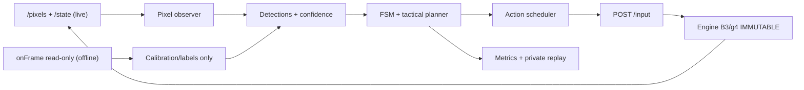
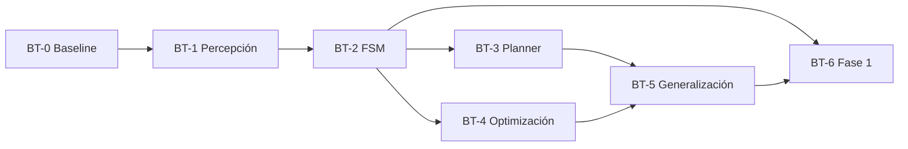

# Plan BT-0→BT-6 — Bot que aprende a completar Ghosts ’n Goblins

**Fecha:** 2026-10-27 · **Rama de referencia:** `main` · **Estado:** PROPUESTA, NO IMPLEMENTADO.
**Objetivo superior:** terminar el juego original con jugabilidad auténtica. **Objetivo del presente plan:** mejorar la habilidad del BOT hasta completar la fase 1 y generalizar al resto, **SIN CAMBIAR EL ENGINE**.

## 0. Límite estricto de alcance

**ENGINE CONGELADO (NO TOCAR):** no modificar ni refactorizar `src/gngb_runtime.mjs`, `src/mc6809_aot*.mjs`, `src/gngb_frame_renderer.mjs`, `scripts/v3_b2c_live.mjs`, `scripts/v3_b2c_engine_worker.mjs`, `scripts/v3_b3_discover.mjs`, selección de bundles, CPU, hardware, ROM, frame pacing, memoria de juego, renderizador ni rutas del servidor. No implementar `saveState`, `cloneBoard`, un endpoint de RAM, una API de observación nueva ni compilación dinámica para servir al bot.

**Implementación permitida:** crear solo nuevos componentes del bot en `bot/`, sus tests en `tests/bot/` y documentación en `docs/`. Los adaptadores podrán importar APIs existentes del runtime **sin editar sus fuentes**, o utilizar endpoints existentes. No introducir cambios en los scripts antiguos de bot salvo decisión explícita posterior. Artefactos de ejecución privados únicamente bajo `out/bot/` (ignorado).

**Interfaces verificadas en el HEAD de partida (b6566eb):**
- Modo en vivo: `GET /pixels` (RGBA real 256×224 con encabezados `X-GnG-Frame`, `X-GnG-Session`), `GET /state` (metadatos, no coordenadas de Arthur), `POST /input` (control/pressed), `POST /continue`, `POST /reset`, `GET /tape`. **No existe endpoint de RAM en vivo.**
- Laboratorio offline: `createBoard` y `onFrame` existentes, lectura de los registros/snapshots del motor sin escribir RAM ni modificar código. Se permite como instrumento externo de calibración y evaluación, sin asumir que esos estados estarán disponibles para el bot en vivo.
- Replays: `scripts/v3_b3_live_replay.mjs`; bundles B3/g4 inmutables y reportes SHA-256 privados. Los controles correctos son `p1.button1=ataque` y `p1.button2=salto`.
- Baseline: `botEvents(seed,...)` / `sustainEvents` de `src/v3_b3_tapes.mjs` y `scripts/v3_b3_live_bot.mjs`. El bot actual favorece direcciones pseudoaleatorias, ataque y salto, y reinserta moneda/Start tras perder: **24.000 frames totales no equivalen a una fase completada**.

**Regla absoluta:** las acciones del bot deben ser exclusivamente pulsaciones/release del puerto original, nunca escrituras de estado, teletransporte, cambios de físicas, ventajas ocultas ni edición del engine. Si el bundle entra en `UNCOMPILED`, registrar tape y bloqueo como problema externo al bot, sin corregir engine en este bloque.

## 1. Arquitectura propuesta (sin infraestructura nueva)

**Estrategia de percepción:** primero imágenes de juego y seguimiento entre frames; la lectura de RAM del laboratorio solo sirve para calibrar detectores/validar medidas, nunca para ofrecer un canal privilegiado que el bot live no posee. No asumir coordenadas, score o identificadores internos sin demostrarlos. Empezar por templates de sprites/tile ROIs y diferencias temporales; evaluar segmentación/opencv solo si la calidad medida es insuficiente.

**Acciones:** macros temporales acotadas (avanzar N frames; atacar; saltar; salto+ataque; agacharse; espera breve), replanificación frecuente con un límite de cambios de botón. No usar créditos automáticos para mejorar métricas de supervivencia. Reset y coin/start se usan en el harness de episodios, nunca para fingir continuidad de la misma vida.

## 2. Métricas y protocolo de evaluación

Cada intento (vida), partida (crédito) y episodio (reset→fin) son unidades **distintas**:
- `stageReached` y `stageCleared`: por evidencia visual/observación de transición real, corroboración offline con oráculo. **Métrica de producto primaria**: completar la fase 1 desde reset sin cheats.
- `maxWorldProgress`: máximo progreso espacial real por vida, deducido de Arthur en pantalla + scroll si hay calibración suficiente; si no, `UNKNOWN`, nunca inventar. Evitar sumar recorridos repetidos tras muerte o nuevo crédito.
- `livesLost`, `damageEvents`, `enemyKills`, `stuckEpisodes`, `survivalFramesPerLife`, `attackHitRate`: registrar solo métricas observables y confiables, con `UNKNOWN` para las no calibradas.
- `haltRate`, `inputLatencyFrames`, `perceptionLatencyMs`, `evaluationWallTime`, `episodeSeed`, `bundleHash`, `inputTapeHash`, `perceptionConfidence`.
- Informar mediana, p25/p75 y tasa de completado **sobre >=10 seeds/episodios pareados**, con política idéntica de créditos/vidas, escena y tiempo; 30 si el coste lo permite. Mismas semillas baseline/candidatos y conjunto held-out para evitar overfitting.

**Criterio de mejora intermedio propuesto:** incremento >=50% de mediana de `maxWorldProgress` frente a baseline o mayor `stageClearRate`, sin deterioro sistemático en muertes/consumo de créditos; si no puede medirse el progreso fiable, **bloquear GO hasta calibración**. Este umbral es experimental y revisable, no garantía.

## 3. Backlog BT-0→BT-6 (tasks y 1–2 niveles de subtareas)

### BT-0 — Baseline y harness de evaluación (P0)

**Depende de:** bundle g4 y endpoints actuales; nada nuevo de engine.
- **T0.1:** implementar `bot/eval/` y runner que compare política pseudoaleatoria actual y un control trivial (right+attack). Probar 10–30 seeds con las mismas condiciones desde reset, cortando por game over/fin de presupuesto. Separar vida/partida/episodio.
- **T0.2:** producir `out/bot/baseline.json`: seeds, hash de bundle/input, indicadores medibles, resumen agregado, más tapes privadas. Evitar afirmar progreso espacial hasta validar la señal.
- **T0.3:** tests ROM-free del evaluador (scoring, repeticiones, vidas, censura por HALT, casos `UNKNOWN`).

**GO:** baseline repetible y métricas auditables; **STOP:** solo se mide frames/score sin distinguir gameplay, se cuenta un continue como progreso, o no se puede alinear el frame de observación.

### BT-1 — Percepción visual robusta (P0)

**Depende de:** BT-0.
- **T1.1:** implementar `bot/perception/` con ROI del HUD, detector/tracker de Arthur y estimador visual de movimiento/scroll; etiquetar un pequeño corpus **privado** de frames auténticos de B3/g4. Diferenciar sprites y fondo; normalizar por desplazamiento de cámara; incluir confidence y estado `UNKNOWN`.
- **T1.2:** añadir detector mínimo de obstáculos, enemigos y proyectiles próximos, más clasificador de pantallas (`TITLE`, `PLAYING`, `READY`, `DEAD`, `CONTINUE`, `STAGE_CLEAR`) únicamente donde sea fiable. Calibrar con registros de laboratorio `onFrame` en **modo solo lectura**, o con observación humana, pero **sin trasladar RAM al bot live**.
- **T1.3:** regresión con datasets reservados (sprites oclusos, scroll, HUD, muerte, colores/animación); medir precisión por clase, false positives y latencia.

**GO:** Arthur rastreado correctamente en >=95% de frames etiquetados de gameplay, clasificador PLAYING/no-PLAYING >=98% en conjunto de prueba; controles en modo seguro si confidence cae. Los umbrales pueden revisarse si bloquean avance sin mejorar resultados.

### BT-2 — FSM reactiva y controles situacionales (P0)

**Depende de:** BT-1.
- **T2.1:** `bot/policy/fsm.mjs` con `WAIT_START → ADVANCE → ATTACK → DODGE → JUMP → RECOVER → STUCK → DEAD/RESPAWN`. Reglas simples y parametrizadas: distancias, aproximación del enemigo, riesgo de proyectil, salto ante obstáculos, cooldown de ataque, histéresis de estados.
- **T2.2:** `bot/control/scheduler.mjs` que emita press/release válidos usando `POST /input`, y escuche `X-GnG-Frame`/`X-GnG-Session`. `GET /pixels` y `GET /state` no son transacciones atómicas entre sí: descartar observaciones desfasadas, resetear tracking al cambiar sesión. No cambiar API.
- **T2.3:** casos negativos: enemigo detrás, pixel estancado, falso positivo de muerte, múltiples enemigos, spawn/respawn, late input. En vivo registrar tape y replay sobre paquete inmóvil.

**GO:** supera baseline en progreso por vida sin consumir más créditos; ante incertidumbre usa acción conservadora, no inputs caóticos. Si percepción resulta débil, volver a BT-1, no modificar CPU/servidor.

### BT-3 — Planificación táctica con horizonte corto (P1)

**Depende de:** BT-2.
- **T3.1:** añadir `bot/planning/` con un modelo **aproximado de decisión**, basado en historial observado: predicción de riesgo de colisión, posiciones relativas, tiempo de salto y avance; acciones candidatas de 5–30 frames. No manipular ni clonar estado del juego.
- **T3.2:** comparar heurísticas FSM frente a beam search ligero o evaluación rolling horizon sobre un predictor explícito (no sobre engine). Usar pérdida de vidas/avance como función de coste; activar planificación solo para amenazas y cruces difíciles.
- **T3.3:** exigir ablation study (FSM sola vs FSM+planificador) por >=10 seeds; límites de cómputo por decisión para no perder el control en vivo.

**GO:** mejora estadísticamente el avance/clearRate de BT-2 y controla el coste de decisión. **STOP:** modelo predice mal o empeora muertes; conservar FSM.

### BT-4 — Optimización de políticas, sin RL pesado inicial (P1)

**Depende de:** BT-0 + BT-2; BT-3 es opcional si todavía no aporta.
- **T4.1:** optimizar thresholds/macros/tiempos FSM con Random Search, CEM o búsqueda evolutiva, usando episodios completos desde **reset** (sin savestates, clonación o escrituras de motor), seeds train y held-out.
- **T4.2:** usar recompensa por progreso **nuevo** por vida, final de fase, supervivencia efectiva, eliminar amenaza y penalización por muerte/atasco. Penalizar explotaciones de score, continuar indefinidamente y rachas sin progreso.
- **T4.3:** persistir política, hiperparámetros, resultados y tape ganadora en `out/bot/`; replay exacto. Evaluar PPO/DQN **solo** si el baseline demostró que reglas/búsqueda no bastan y existe un entorno de entrenamiento estable y coste razonable sin tocar engine.

**GO:** política aprendida supera FSM en conjunto held-out, o se conserva la más simple si el beneficio no es real.

### BT-5 — Generalización por segmentos/amenazas (P1)

**Depende de:** BT-2 y al menos una política candidata.
- **T5.1:** extraer desde ejecución real un mapa **observacional** de hitos por scroll y obstáculos, sin codificar posiciones de Arthur mediante cheating. Conocer segmentos ya superados puede guiar tácticas, nunca saltar a ellos.
- **T5.2:** biblioteca de tácticas reutilizables por amenaza (zombi, proyectil, terreno, aparición múltiple). Replanificar con observación fresca; evitar memorizar un único replay frágil.
- **T5.3:** test de robustez ante offsets de entrada, número de enemigos, secuencias y variaciones de vidas. Registrar cuellos de botella por segmento.

**GO:** el bot avanza por segmentos en múltiples condiciones, sin depender de una única semilla.

### BT-6 — Certificación de fase 1 y transición a otras fases (P0 objetivo final del bloque)

**Depende de:** BT-2 a BT-5 según resultado; no esperar todas las técnicas si BT-2 basta.
- **T6.1:** obtener **al menos una partida limpia** desde reset hasta transición auténtica de fase 1, sin inyección de RAM ni estado, sin continuaciones que falseen una vida. Conservar tape y capturas privadas.
- **T6.2:** reproducir los inputs en el **mismo bundle congelado**, comprobar resultado y usar MAME como oráculo externo de forma solo lectura/inputs normales (comparación de checkpoints, sin modificar engine).
- **T6.3:** evaluar otras seeds/condiciones; informar `stageClearRate` y puntos de fracaso. Si aparece `UNCOMPILED`, **BLK_ENGINE_EXTERNAL** con tape exacta: derivar a otro workstream de engine, nunca resolverlo dentro de este plan.

**GO:** `BT_PHASE1_CLEAR=PASS_REAL_AOT_GAMEPLAY` con replay y evidencia de transición auténtica. **No declara juego 100% completo**: generalizar a siguientes fases después.

## 4. Orden de trabajo recomendado y checkpoints

**Primera entrega acotada:** `BT-0 + BT-1` (baseline medible y percepción validada). Después `BT-2` (FSM competitiva). No empezar BT-3/BT-4 hasta demostrar que el bot interpreta el escenario correctamente.

**Checkpoint 1:** métricas + observaciones confiables.
**Checkpoint 2:** FSM mejora el progreso por vida sobre bot aleatorio.
**Checkpoint 3:** primera fase superada y cinta reproducible; planificación/optimización opcionales según necesidad.

## 5. Evidencia, STOP/GO y handoff

- Reportar para cada tarea `NOT_STARTED | IN_PROGRESS | PASS | PARTIAL | BLOCKED`; solo llamar PASS a una prueba efectivamente ejecutada.
- Incluir `HEAD`, hash de bundle, seeds, perfiles, número de partidas reales, progreso por vida, tasa de clear, costes, baseline comparado, assets privados y próximo bloqueo.
- `STOP` si se requiere modificar engine, introducir endpoint, leer RAM en live sin API preexistente, usar acciones fuera de /input, usar un intérprete MC6809, fabricar estados gráficos, o publicar ROM/screenhots/trazas protegidas. Registrar dependencia externa y continuar con trabajo puramente del bot que no la requiera.
- El plan **puede cambiar** si la evidencia muestra un algoritmo mejor, pero no cambia el objetivo central ni la prohibición de tocar engine.

### Prompt corto para agente local

> Trabaja **exclusivamente en el bot** de `krukmat/gng-ghidra`; lee `docs/agents/gng-bot-gameplay-plan-2026-10-27.md`. **PROHIBIDO modificar engine/AOT/renderer/servidor, ROM o bundles.** Usa solo `/pixels`, `/state`, `/input`, `/tape` y wrappers offline de lectura sobre APIs existentes. Implementa BT-0/BT-1 primero con tests, baseline pareado y métricas de progreso real por vida; sigue BT-2 FSM y después planificación/optimización solo si mejoran la capacidad de completar fase 1. Commit de código en rutas nuevas `bot/`, `tests/bot/` y documentación. Reporta gates y bloqueos; si falta cobertura AOT, captura tape y remite como dependencia **externa al bot**, sin tocar engine.
