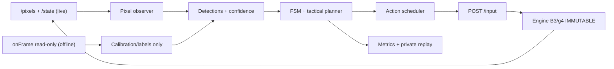
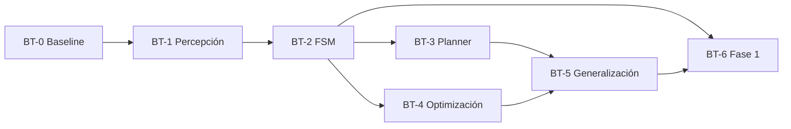

# Plan BT-0→BT-6 — Bot que aprende a completar Ghosts ’n Goblins

**Fecha:** 2026-10-27 · **Rama de referencia:** `main` · **Estado:** IMPLEMENTACIÓN PARCIAL; M1 demostrado en el caso de desarrollo 2672; M2 BLOQUEADO por `UNCOMPILED` externo tras 90 de 120 frames en tierra; ninguna fase completada.
**Objetivo superior:** terminar el juego original con jugabilidad auténtica. **Objetivo del presente plan:** mejorar la habilidad del BOT hasta completar la fase 1 y generalizar al resto, **SIN CAMBIAR EL ENGINE**.

**Dirección actual:** cerrar una habilidad de agua completa antes de ampliar la arquitectura o la búsqueda. La sincronización del prefijo está verificada en una ejecución; el controlador visual offline confirma embarque estable en el caso de desarrollo 2672 (M1); el segundo salto (M2) aterriza en la orilla derecha, pero el bundle g4 se detiene con `UNCOMPILED` en x≈1905 antes de completar la ventana. Ver [Resultado M2](#resultado-m2-2026-10-27). Las [tareas inmediatas y sus criterios](#entregas-medibles-vigentes) prevalecen sobre el orden inicial BT-0→BT-6. La [evaluación y evidencia histórica](gng-bot-evaluacion-2026-10-27.md) conserva el diagnóstico; no se reproduce aquí.

## Entregas medibles vigentes

### Línea base y próximos hitos

Base actual: `node bot/run-water.mjs`, fuente `out/bot/late-sweep/trial-6.json`, intervención visual desde 2672, horizonte 3100, bundle g4 congelado. Baseline anterior: máximo x=1776, final x=1719, cero vidas, `NOT_CONFIRMED`, `STOP/BOARDING_NOT_CENTERED` en 2870. Candidata M1: `LANDED` en 2861, ventana 2861–2980 con 120/120 frames `LANDED` y 118 con apoyo visual, cero vidas en 3100 frames; `node bot/verify-boarding.mjs <report.json>` lo confirma por otra vía. Única condición evaluada: no es una tasa de éxito. Los 114 tests verifican contratos; no cuentan como partidas ganadas.

| Hito | Criterio de aprobación | Estado |
| --- | --- | --- |
| M0 — Controles reproducibles | Tape efectiva y prevista equivalentes; replay exacto del prefijo | PASS en la ejecución documentada: 214/214 transiciones, cero ciclos de diferencia |
| M1 — Embarque estable | Llegar a la plataforma y conservar apoyo durante una ventana posterior de 120 frames, sin perder vidas; evidencia visual y replay verificables | PASS en una condición (2672): replay independiente desde reset, y=60 constante, transporte 74 px sin dirección pulsada, imágenes revisadas. STOP posterior en 3035 |
| M2 — Cruce completo | Salir de la plataforma, aterrizar en la orilla opuesta y mantener apoyo/avance en tierra durante 120 frames, sin pérdida de vida durante la habilidad | BLOCKED (externo) en 2672: aterrizaje en 3043 y 90/90 frames en tierra con avance de +100 px y cero vidas perdidas; `UNCOMPILED` (pc `0xAFFC`) en 3132. [Resultado M2](#resultado-m2-2026-10-27) |
| M3 — Robustez y ejecución live | Comparación pareada: hasta tres condiciones de desarrollo y una reservada, fijadas antes de evaluar; publicar todos los resultados. Repetir el caso nominal con control reactivo live y verificar su tape efectiva | PENDIENTE; cuatro condiciones son una prueba exploratoria, no una tasa general |
| M4 — Fase 1 | Partida desde reset hasta transición auténtica, tape reproducible y contraste externo previsto en BT-6 | PENDIENTE |
| M5 — Juego completo | Incorporar y verificar los siguientes segmentos y transiciones hasta el final real del juego | PENDIENTE; M4 no acredita M5 |

No promover M1 usando solo el estado `LANDED` del propio controlador: contrastar sus apoyos con las imágenes y evaluación independiente de lectura. Una oclusión breve puede recuperarse con incertidumbre explícita y límites temporales; una estimación sin evidencia no acredita apoyo. Una parada en la orilla tampoco acredita M1/M2.

### Resultado M1 (2026-10-27)

- **Causa observada (M1.1):** Arthur estaba apoyado desde 2845–2846 hasta el final: y=60 en plataforma (orilla 62, agua 26), tres vidas y transporte horizontal con entrada neutra. Los dos extremos de la isla quedaban ocultos por Arthur y por un sprite dorado no identificado, dibujado bajo él en coordenadas de pantalla. Solo quedaba verde interior entre las piernas.
- **Corrección (M1.2):** `water-observation.mjs` conserva la extensión relativa al cuerpo del último frame con borde visible. Exige verde actual dentro de ella y bajo el cuerpo, la cabeza a la misma altura (±4 px) y como máximo 240 frames (`HELD_BODY_RELATIVE_UNDER_OCCLUSION`). En la candidata solo cubrió 2856–2859; después el borde izquierdo volvió a verse. Hay regresiones del fallo, de caída, de verde ausente o externo y del límite temporal. Control negativo real: la caída de la tape fuente (vida perdida en 2881) no produce ningún frame de apoyo ISLAND.
- **Criterio del runner:** ahora exige 120 frames `LANDED` desde el aterrizaje y cero vidas perdidas en todo el horizonte. Antes exigía `LANDED` en el último frame. La primera parada se publica en `stop`.
- **Evidencia:** baseline `out/bot/water-skill-2026-10-27T14-04-05-800Z/`; candidata `out/bot/water-skill-2026-10-27T14-09-25-258Z/{report.json,tape.json,verify-boarding.json,verify-window.png}`. Hash de la tape `4eaf8d51…`; último registro `1eb3193b…`, idéntico en dos ejecuciones y en el replay.
- **Próximo bloqueo (M2):** STOP `PLAYER_OR_BANK_LOST` en 3035. Durante el transporte, la orilla izquierda sale de pantalla. `detectWaterTerrain` y la habilidad necesitan esa orilla para ubicar la isla, así que el caso falla antes del segundo salto. El caso reservado 2668 sigue sin evaluar.

### Resultado M2 (2026-10-27)

- **M2.1 — Viabilidad (solo evaluación):** la plataforma oscila entre x≈1666 y x≈1782 (~0,8 px/frame) y no causa pérdidas hasta 3700. La orilla derecha empieza en x≈1784 (346/366 frames visuales coinciden), a altura 62, igual que la izquierda. Barrido de la tape candidata (salto en F, 2862–3240, paso 2): con 4 frames de carrera, todo despegue en x≥1745 aterriza en la orilla (x 1790–1821, vuelo de 37–44 frames). En x≤1744 cae al agua y pierde vida. Arthur quieto en la orilla aguanta más de 400 frames. **Bloqueo:** las 165 variantes que pasan por x≈1905–1908 terminan en `UNCOMPILED` (pc `0xAFFC`), con independencia del frame. La franja de tierra llega hasta x≈1959.
- **M2.2 — Percepción:** `terrain-water.mjs` detecta segmentos de tierra (`landSegments`). `rightBank` ya no exige la orilla izquierda ni la isla: es la primera tierra separada del borde de pantalla, de la orilla y de la isla. `water-observation.mjs` mantiene la extensión de la isla, relativa al cuerpo, sin orilla izquierda y emite apoyo `RIGHT_BANK` solo con pies sobre tierra a la altura de orilla. Regresiones: isla mantenida tras salir la orilla de pantalla, caída sin falso apoyo, tierra frente a agua y detección de la orilla lejana.
- **M2.3 — Política:** `water-skill.mjs` tiene las fases `HOP_RUNUP` → `HOP_AIRBORNE` → `ASHORE`, opcionales (`hopMaxDistancePx`, nulo por defecto). Solo saltan desde apoyo ISLAND con `rightBank.left − arthur.x ∈ [0, 28]`; 28 px equivale a x≥1756 al iniciar la carrera, más de 11 px sobre el umbral medido. El aterrizaje exige dos muestras `RIGHT_BANK` a partir de `flightFrames − jumpHoldFrames`. En tierra avanza y se detiene a `takeoffBufferPx` del borde. Para con botones liberados si falta el aterrizaje o el apoyo. `mainland-hop.mjs` no se conectó porque exige confianza, `lifeKey` y `playing`, que el observador no produce. Suite: 121/121 PASS.
- **M2.4 — Episodio (fuente `trial-6`, 2672→3300, bundle `356bbfde…`):** el baseline (código M1 = HEAD `b428656`) hace STOP `PLAYER_OR_BANK_LOST` en 3035, con FRAMES_DONE, cero vidas perdidas y x máx. 1779. La candidata mantiene la ventana M1 (120/120 `LANDED`), carrera en 2999, salto en 3003 y `ASHORE` en 3043. Después hay 90/90 frames `ASHORE` avanzando, con 68 de apoyo visual: el resto es animación de marcha con 5 px de amplitud, más de los 4 calibrados. Termina con `UNCOMPILED` en 3132 (x=1907) y cero vidas perdidas. Dos ejecuciones dan la misma tape (`6e196431…`) y las mismas observaciones. `node bot/verify-crossing.mjs <report.json>` (replay independiente desde reset) confirma y=62 en los 90 frames, x 1807→1907 monótona, cero vidas perdidas y los mismos hashes y final. Solo fallan `framesDone` y `windowComplete`. `verify-boarding.mjs` reproduce M1 en la misma tape, salvo `framesDone`. Imágenes revisadas: `verify-crossing.png`.
- **M2.5 — Decisión:** M2 **BLOCKED por dependencia externa**, no por fallo jugable. Hubo un solo cambio dirigido, sin ajuste de parámetros. No se acorta el avance para esquivar x≈1905: usar un hueco del bundle como regla de juego sería una ventaja oculta. Evidencia: `out/bot/m2-feasibility-2026-10-27/` (scripts y barridos de M2.1), baseline `out/bot/water-skill-2026-10-27T14-58-17-678Z/` y candidatas `…T14-58-21-949Z/` y `…T14-58-25-262Z/`.
- **Coste:** barrido M2.1, ~380 replays de ~0,7 s (~5 min en total); episodio ~3 s; verificación ~2 s.
- **Próximo bloqueo:** la cobertura del bundle g4 en pc `0xAFFC` al cruzar x≈1905 es trabajo del motor y queda fuera del alcance del bot. Cuando un bundle la cubra, repetir M2.4 sin cambios: la franja permite ~150 frames de marcha. Pendientes de M2 fuera de este bloqueo: el caso reservado 2668, sin evaluar, y la calibración del apoyo en marcha (5 px).

### Tareas del bloque M2 (referencia; ejecutadas el 2026-10-27)

**Contexto para retomar en una sesión limpia:**
- Repositorio: `/Users/matias/gng-ghidra`. Pedir los porcentajes restantes de 5 horas y semana y esperar antes de empezar; estimar el bloque y registrar su coste. Tras aceptación del trabajo, pedir cuotas finales y hacer la retrospectiva requerida por el operador.
- Cambios locales de M1 sin commit: `bot/perception/water-observation.mjs`, `bot/run-water.mjs`, `tests/bot/water-observation.test.mjs`, este plan y `bot/verify-boarding.mjs` (no rastreado). Conservarlos y revisar `git status` antes de editar. No tocar el directorio anidado ajeno `gng-ghidra/`; no hacer commit/push sin autorización.
- Punto de partida: candidata M1 (rutas en [Resultado M1](#resultado-m1-2026-10-27)). `node bot/run-water.mjs [fuente] [inicio] [fin]` admite hasta 1800 frames; el horizonte documentado es 3100. En 3035 la orilla izquierda ya no está en pantalla: `detectWaterTerrain` devuelve `island=null` sin ella y `water-skill.mjs` para tras 12 frames sin cuerpo u orilla.
- Piezas existentes, sin validar en juego real: `terrain-water.mjs` ya emite `rightBank` (`verified:false`); `bot/policy/mainland-hop.mjs` implementa el segundo salto (espera, intercepción prevista, `LANDED` tras dos confirmaciones) y no está conectado al runner; `boss-water-journey.mjs` exige un gate de derrota que ningún detector produce: no convertirlo en requisito sin evidencia.
- Etiquetas RAM solo para evaluación: x de mundo `0xa0:0xa1`, altura `0xa2:0xa3`, vidas `0x60`. Alturas medidas: orilla izquierda 62, plataforma 60, agua/caída 26; la orilla derecha está por medir.
- Calibración del primer salto (`flightFrames=38`, `runSpeedPxPerFrame=1.085`, `takeoffBufferPx=16`, `runLeadFrames=4`): no recalibrar sin contradicción observada. El segundo salto parte de una plataforma en movimiento; medirlo antes de reutilizar esos valores.
- `bot/verify-boarding.mjs` es el modelo de verificación independiente: replay desde reset sin política ni percepción, hashes, vidas, altura, transporte y hoja de imágenes. M2 necesita su propio criterio (altura de orilla y avance en tierra).
- Coste medido: un episodio ~3 s y una verificación ~1 s. Suite `node --test tests/bot/*.test.mjs`: 114/114 PASS. El ffmpeg local no tiene `drawtext`.
- Caso de desarrollo 2672; `startFrame=2668` sigue reservado y sin evaluar. Alcance: M2.1–M2.5; dejar live, otras condiciones, combate y el resto de la fase para entregas posteriores.

1. **M2.1 — Viabilidad offline (primero; es lo más barato):** ampliar el horizonte de la candidata y medir con etiquetas e imágenes cuándo entra la orilla derecha, la trayectoria y velocidad de la plataforma (si se acerca, se aleja o invierte) y en qué frames un salto desde la plataforma aterriza en la orilla sin perder vida (variantes de la tape candidata con el salto en cada frame). Solo evaluación: la política no recibe estos datos. Si ningún salto es viable, informar y detener el bloque.
2. **M2.2 — Percepción sin orilla izquierda:** una corrección causal que conserve la isla cuando la orilla izquierda sale de pantalla y valide `rightBank` con imágenes. Regresión del STOP de 3035 y control negativo de caída sin falso apoyo.
3. **M2.3 — Segundo salto:** conectar `mainland-hop.mjs` o fases equivalentes tras `LANDED`, con parámetros medidos en M2.1; liberar botones al parar; regresiones sintéticas.
4. **M2.4 — Episodio real y verificación:** baseline (código M1) y candidata con idéntica fuente, bundle y horizonte. Criterio del runner: aterrizaje en la orilla derecha y 120 frames de apoyo/avance en tierra, cero vidas perdidas. Verificador independiente desde reset (altura de orilla, avance de x, vidas, hashes) más hoja de imágenes; dos ejecuciones idénticas.
5. **M2.5 — Decisión e informe:** aprobar M2 con evidencia o informar por qué falla, con la misma regla de tres cambios dirigidos que M1. Actualizar este plan con resultado, coste y próximo bloqueo.

### Tareas del bloque M1 (cerrado; referencia)

**Contexto para retomar en una sesión limpia:**
- Repositorio: `/Users/matias/gng-ghidra`. Pedir los porcentajes restantes de 5 horas y semana y esperar antes de empezar; estimar el bloque y registrar su coste. Tras aceptación del trabajo, pedir cuotas finales y hacer la retrospectiva requerida por el operador.
- Hay cambios locales sin commit, incluidos componentes nuevos no rastreados: conservarlos y revisar `git status` antes de editar. No tocar el directorio anidado ajeno `gng-ghidra/`; no hacer commit/push sin autorización.
- Evidencia exacta del último ensayo: `out/bot/water-skill-2026-10-27T13-25-30-102Z/{report.json,tape.json,replay-check.json}` y capturas en ese directorio. `BOARDING` comienza en 2849; el fallo termina en 2870. El replay ya coincide; no repetir la auditoría general de sincronización.
- Circuito conectado: `bot/visual-episode.mjs` → `bot/perception/water-observation.mjs` (usa `terrain-water.mjs`) → `bot/policy/water-skill.mjs`, orquestado por `bot/run-water.mjs`. Las etiquetas RAM quedan en evaluación separada. El observador no acredita derrota de enemigo ni vida y su apoyo sigue siendo experimental.
- Causa candidata: los fragmentos verdes y el historial de anchura sostienen la geometría mientras hay un extremo visible; al quedar ambos extremos ocultos por Arthur se pierde la plataforma. `BOARDING` emite neutral ante esa pérdida y no confirma centrado. Revisar imágenes antes de decidir qué componente corregir.
- Calibración causal existente: derecha+salto simultáneos desde reposo producen salto vertical; cuatro frames de carrera antes del salto producen avance horizontal. Configuración actual: `flightFrames=38`, `runSpeedPxPerFrame=1.085`, `takeoffBufferPx=16`, `runLeadFrames=4`. No recalibrar sin una contradicción observada.
- `startFrame=2668` está propuesto como caso reservado aún no evaluado: no usarlo para ajustar. El caso nominal de desarrollo empieza en 2672.
- Entorno previamente verificado: Node v22.23.0, Python 3.15, ffmpeg `/opt/homebrew/bin/ffmpeg`, sin PIL; ROM local `roms/gng.zip`, bundle `out/v3/b3/g4/frozen`. Comprobar compatibilidad antes de pruebas costosas. Última suite: `node --test tests/bot/*.test.mjs`, 112/112 PASS; repetir tras cambios relevantes, sin cobertura ni suites ajenas al bot.
- Alcance de la próxima sesión: M1.1–M1.4. Dejar segundo salto, live, generalización y otras fases para entregas posteriores; mantener motor congelado y los límites de la sección 0.

1. **M1.1 — Reproducir el fallo:** usar la tape y la secuencia alrededor de 2849–2870 del último ensayo. Etiquetar los intervalos de apoyo visible, oclusión e incertidumbre. Conservar casos de caída como controles negativos.
2. **M1.2 — Una corrección causal:** mejorar continuidad de la geometría bajo oclusión o la decisión que depende de ella, según M1.1; añadir una regresión del fallo concreto y de un falso apoyo. Mantener separados observación, inferencia y evaluación.
3. **M1.3 — Episodio real:** ejecutar baseline y candidata con idéntica fuente, horizonte y bundle desde reset; ampliar el horizonte de ambos si hace falta para observar 120 frames posteriores. Inspeccionar apoyo, vidas y tape. Reproducir independientemente cualquier candidata aprobada.
4. **M1.4 — Decisión:** aprobar M1 con evidencia o informar por qué falla. Tras tres cambios dirigidos sin mejorar el criterio, detener el ajuste de parámetros y revisar la hipótesis con una demostración normal del tramo o análisis de sus imágenes. No sustituirlo por un barrido mayor.

El runner actual produce las trazas necesarias para investigar M1, pero no certifica M2/M3. Sus criterios y el protocolo de condiciones deben implementarse antes de declarar esos hitos superados. No contar repeticiones de una tape determinista como condiciones independientes; si se ajusta sobre el caso reservado, deja de ser reservado.

### Reporte obligatorio por bloque

Informar **hito antes → después**, éxitos/episodios evaluables por condición, pérdidas de vida, paradas por percepción, mayor intervalo sin seguimiento y coste de ejecución. Separar HALT o evidencia insuficiente de los fallos jugables y publicar sus cantidades; no borrarlos del balance. Adjuntar hashes, configuración y rutas privadas de reporte/tape. Para la habilidad, priorizar hito confirmado y supervivencia; conservar x máximo como diagnóstico secundario. No declarar menor daño si esa métrica sigue sin calibrar.

Cada bloque termina con una capacidad nueva demostrada o una hipótesis descartada con evidencia y la siguiente prueba concreta. No ampliar entrenamiento, planificación ni infraestructura antes de comprobar que resuelve el bloqueo medido. La validación amplia de BT-0/BT-5 sigue pendiente después de la prueba exploratoria.

## 0. Límite estricto de alcance

**ENGINE CONGELADO (NO TOCAR):** no modificar ni refactorizar `src/gngb_runtime.mjs`, `src/mc6809_aot*.mjs`, `src/gngb_frame_renderer.mjs`, `scripts/v3_b2c_live.mjs`, `scripts/v3_b2c_engine_worker.mjs`, `scripts/v3_b3_discover.mjs`, selección de bundles, CPU, hardware, ROM, frame pacing, memoria de juego, renderizador ni rutas del servidor. No implementar `saveState`, `cloneBoard`, un endpoint de RAM, una API de observación nueva ni compilación dinámica para servir al bot.

**Implementación permitida:** crear solo nuevos componentes del bot en `bot/`, sus tests en `tests/bot/` y documentación en `docs/`. Los adaptadores podrán importar APIs existentes del runtime **sin editar sus fuentes**, o utilizar endpoints existentes. No introducir cambios en los scripts antiguos de bot salvo decisión explícita posterior. Artefactos de ejecución privados únicamente bajo `out/bot/` (ignorado).

**Interfaces verificadas en el HEAD de partida (b6566eb):**
- Modo en vivo: `GET /pixels` (RGBA real 256×224 con encabezados `X-GnG-Frame`, `X-GnG-Session`), `GET /state` (metadatos, no coordenadas de Arthur), `POST /input` (control/pressed), `POST /continue`, `POST /reset`, `GET /tape`. **No existe endpoint de RAM en vivo.**
- Laboratorio offline: `createBoard` y `onFrame` existentes, lectura de los registros/snapshots del motor sin escribir RAM ni modificar código. Se permite como instrumento externo de calibración y evaluación, sin asumir que esos estados estarán disponibles para el bot en vivo.
- Replays: `scripts/v3_b3_live_replay.mjs`; bundles B3/g4 inmutables y reportes SHA-256 privados. Los controles correctos son `p1.button1=ataque` y `p1.button2=salto`.
- Baseline: `botEvents(seed,...)` / `sustainEvents` de `src/v3_b3_tapes.mjs` y `scripts/v3_b3_live_bot.mjs`. El bot actual favorece direcciones pseudoaleatorias, ataque y salto, y reinserta moneda/Start tras perder: **24.000 frames totales no equivalen a una fase completada**.

**Regla absoluta:** las acciones del bot deben ser exclusivamente pulsaciones/release del puerto original, nunca escrituras de estado, teletransporte, cambios de físicas, ventajas ocultas ni edición del engine. Si el bundle entra en `UNCOMPILED`, registrar tape y bloqueo como problema externo al bot, sin corregir engine en este bloque.

## 1. Arquitectura propuesta (sin infraestructura nueva)

**Estrategia de percepción:** primero imágenes de juego y seguimiento entre frames; la lectura de RAM del laboratorio solo sirve para calibrar detectores/validar medidas, nunca para ofrecer un canal privilegiado que el bot live no posee. No asumir coordenadas, score o identificadores internos sin demostrarlos. Empezar por templates de sprites/tile ROIs y diferencias temporales; evaluar segmentación/opencv solo si la calidad medida es insuficiente.

**Acciones:** macros temporales acotadas (avanzar N frames; atacar; saltar; salto+ataque; agacharse; espera breve), replanificación frecuente con un límite de cambios de botón. No usar créditos automáticos para mejorar métricas de supervivencia. Reset y coin/start se usan en el harness de episodios, nunca para fingir continuidad de la misma vida.

## 2. Métricas y protocolo de evaluación

Cada intento (vida), partida (crédito) y episodio (reset→fin) son unidades **distintas**:
- `stageReached` y `stageCleared`: por evidencia visual/observación de transición real, corroboración offline con oráculo. **Métrica de producto primaria**: completar la fase 1 desde reset sin cheats.
- `maxWorldProgress`: máximo progreso espacial real por vida, deducido de Arthur en pantalla + scroll si hay calibración suficiente; si no, `UNKNOWN`, nunca inventar. Evitar sumar recorridos repetidos tras muerte o nuevo crédito.
- `livesLost`, `damageEvents`, `enemyKills`, `stuckEpisodes`, `survivalFramesPerLife`, `attackHitRate`: registrar solo métricas observables y confiables, con `UNKNOWN` para las no calibradas.
- `haltRate`, `inputLatencyFrames`, `perceptionLatencyMs`, `evaluationWallTime`, `episodeSeed`, `bundleHash`, `inputTapeHash`, `perceptionConfidence`.
- Informar mediana, p25/p75 y tasa de completado **sobre >=10 seeds/episodios pareados**, con política idéntica de créditos/vidas, escena y tiempo; 30 si el coste lo permite. Mismas semillas baseline/candidatos y conjunto held-out para evitar overfitting.

**Criterio de mejora intermedio propuesto:** incremento >=50% de mediana de `maxWorldProgress` frente a baseline o mayor `stageClearRate`, sin deterioro sistemático en muertes/consumo de créditos; si no puede medirse el progreso fiable, **bloquear GO hasta calibración**. Este umbral es experimental y revisable, no garantía.

## 3. Backlog BT-0→BT-6 (tasks y 1–2 niveles de subtareas)

### BT-0 — Baseline y harness de evaluación (P0)

**Depende de:** bundle g4 y endpoints actuales; nada nuevo de engine.
- **T0.1:** implementar `bot/eval/` y runner que compare política pseudoaleatoria actual y un control trivial (right+attack). Probar 10–30 seeds con las mismas condiciones desde reset, cortando por game over/fin de presupuesto. Separar vida/partida/episodio.
- **T0.2:** producir `out/bot/baseline.json`: seeds, hash de bundle/input, indicadores medibles, resumen agregado, más tapes privadas. Evitar afirmar progreso espacial hasta validar la señal.
- **T0.3:** tests ROM-free del evaluador (scoring, repeticiones, vidas, censura por HALT, casos `UNKNOWN`).

**GO:** baseline repetible y métricas auditables; **STOP:** solo se mide frames/score sin distinguir gameplay, se cuenta un continue como progreso, o no se puede alinear el frame de observación.

### BT-1 — Percepción visual robusta (P0)

**Depende de:** BT-0.
- **T1.1:** implementar `bot/perception/` con ROI del HUD, detector/tracker de Arthur y estimador visual de movimiento/scroll; etiquetar un pequeño corpus **privado** de frames auténticos de B3/g4. Diferenciar sprites y fondo; normalizar por desplazamiento de cámara; incluir confidence y estado `UNKNOWN`.
- **T1.2:** añadir detector mínimo de obstáculos, enemigos y proyectiles próximos, más clasificador de pantallas (`TITLE`, `PLAYING`, `READY`, `DEAD`, `CONTINUE`, `STAGE_CLEAR`) únicamente donde sea fiable. Calibrar con registros de laboratorio `onFrame` en **modo solo lectura**, o con observación humana, pero **sin trasladar RAM al bot live**.
- **T1.3:** regresión con datasets reservados (sprites oclusos, scroll, HUD, muerte, colores/animación); medir precisión por clase, false positives y latencia.

**GO:** Arthur rastreado correctamente en >=95% de frames etiquetados de gameplay, clasificador PLAYING/no-PLAYING >=98% en conjunto de prueba; controles en modo seguro si confidence cae. Los umbrales pueden revisarse si bloquean avance sin mejorar resultados.

### BT-2 — FSM reactiva y controles situacionales (P0)

**Depende de:** BT-1.
- **T2.1:** `bot/policy/fsm.mjs` con `WAIT_START → ADVANCE → ATTACK → DODGE → JUMP → RECOVER → STUCK → DEAD/RESPAWN`. Reglas simples y parametrizadas: distancias, aproximación del enemigo, riesgo de proyectil, salto ante obstáculos, cooldown de ataque, histéresis de estados.
- **T2.2:** `bot/control/scheduler.mjs` que emita press/release válidos usando `POST /input`, y escuche `X-GnG-Frame`/`X-GnG-Session`. `GET /pixels` y `GET /state` no son transacciones atómicas entre sí: descartar observaciones desfasadas, resetear tracking al cambiar sesión. No cambiar API.
- **T2.3:** casos negativos: enemigo detrás, pixel estancado, falso positivo de muerte, múltiples enemigos, spawn/respawn, late input. En vivo registrar tape y replay sobre paquete inmóvil.

**GO:** supera baseline en progreso por vida sin consumir más créditos; ante incertidumbre usa acción conservadora, no inputs caóticos. Si percepción resulta débil, volver a BT-1, no modificar CPU/servidor.

### BT-3 — Planificación táctica con horizonte corto (P1)

**Depende de:** BT-2.
- **T3.1:** añadir `bot/planning/` con un modelo **aproximado de decisión**, basado en historial observado: predicción de riesgo de colisión, posiciones relativas, tiempo de salto y avance; acciones candidatas de 5–30 frames. No manipular ni clonar estado del juego.
- **T3.2:** comparar heurísticas FSM frente a beam search ligero o evaluación rolling horizon sobre un predictor explícito (no sobre engine). Usar pérdida de vidas/avance como función de coste; activar planificación solo para amenazas y cruces difíciles.
- **T3.3:** exigir ablation study (FSM sola vs FSM+planificador) por >=10 seeds; límites de cómputo por decisión para no perder el control en vivo.

**GO:** mejora estadísticamente el avance/clearRate de BT-2 y controla el coste de decisión. **STOP:** modelo predice mal o empeora muertes; conservar FSM.

### BT-4 — Optimización de políticas, sin RL pesado inicial (P1)

**Depende de:** BT-0 + BT-2; BT-3 es opcional si todavía no aporta.
- **T4.1:** optimizar thresholds/macros/tiempos FSM con Random Search, CEM o búsqueda evolutiva, usando episodios completos desde **reset** (sin savestates, clonación o escrituras de motor), seeds train y held-out.
- **T4.2:** usar recompensa por progreso **nuevo** por vida, final de fase, supervivencia efectiva, eliminar amenaza y penalización por muerte/atasco. Penalizar explotaciones de score, continuar indefinidamente y rachas sin progreso.
- **T4.3:** persistir política, hiperparámetros, resultados y tape ganadora en `out/bot/`; replay exacto. Evaluar PPO/DQN **solo** si el baseline demostró que reglas/búsqueda no bastan y existe un entorno de entrenamiento estable y coste razonable sin tocar engine.

**GO:** política aprendida supera FSM en conjunto held-out, o se conserva la más simple si el beneficio no es real.

### BT-5 — Generalización por segmentos/amenazas (P1)

**Depende de:** BT-2 y al menos una política candidata.
- **T5.1:** extraer desde ejecución real un mapa **observacional** de hitos por scroll y obstáculos, sin codificar posiciones de Arthur mediante cheating. Conocer segmentos ya superados puede guiar tácticas, nunca saltar a ellos.
- **T5.2:** biblioteca de tácticas reutilizables por amenaza (zombi, proyectil, terreno, aparición múltiple). Replanificar con observación fresca; evitar memorizar un único replay frágil.
- **T5.3:** test de robustez ante offsets de entrada, número de enemigos, secuencias y variaciones de vidas. Registrar cuellos de botella por segmento.

**GO:** el bot avanza por segmentos en múltiples condiciones, sin depender de una única semilla.

### BT-6 — Certificación de fase 1 y transición a otras fases (P0 objetivo final del bloque)

**Depende de:** BT-2 a BT-5 según resultado; no esperar todas las técnicas si BT-2 basta.
- **T6.1:** obtener **al menos una partida limpia** desde reset hasta transición auténtica de fase 1, sin inyección de RAM ni estado, sin continuaciones que falseen una vida. Conservar tape y capturas privadas.
- **T6.2:** reproducir los inputs en el **mismo bundle congelado**, comprobar resultado y usar MAME como oráculo externo de forma solo lectura/inputs normales (comparación de checkpoints, sin modificar engine).
- **T6.3:** evaluar otras seeds/condiciones; informar `stageClearRate` y puntos de fracaso. Si aparece `UNCOMPILED`, **BLK_ENGINE_EXTERNAL** con tape exacta: derivar a otro workstream de engine, nunca resolverlo dentro de este plan.

**GO:** `BT_PHASE1_CLEAR=PASS_REAL_AOT_GAMEPLAY` con replay y evidencia de transición auténtica. **No declara juego 100% completo**: generalizar a siguientes fases después.

## 4. Orden de trabajo recomendado y checkpoints

**Primera entrega acotada:** `BT-0 + BT-1` (baseline medible y percepción validada). Después `BT-2` (FSM competitiva). No empezar BT-3/BT-4 hasta demostrar que el bot interpreta el escenario correctamente.

**Checkpoint 1:** métricas + observaciones confiables.
**Checkpoint 2:** FSM mejora el progreso por vida sobre bot aleatorio.
**Checkpoint 3:** primera fase superada y cinta reproducible; planificación/optimización opcionales según necesidad.

## 5. Evidencia, STOP/GO y handoff

- Reportar para cada tarea `NOT_STARTED | IN_PROGRESS | PASS | PARTIAL | BLOCKED`; solo llamar PASS a una prueba efectivamente ejecutada.
- Incluir `HEAD`, hash de bundle, seeds, perfiles, número de partidas reales, progreso por vida, tasa de clear, costes, baseline comparado, assets privados y próximo bloqueo.
- `STOP` si se requiere modificar engine, introducir endpoint, leer RAM en live sin API preexistente, usar acciones fuera de /input, usar un intérprete MC6809, fabricar estados gráficos, o publicar ROM/screenhots/trazas protegidas. Registrar dependencia externa y continuar con trabajo puramente del bot que no la requiera.
- El plan **puede cambiar** si la evidencia muestra un algoritmo mejor, pero no cambia el objetivo central ni la prohibición de tocar engine.

### Prompt corto para agente local

> Trabaja **exclusivamente en el bot** de `krukmat/gng-ghidra`; lee `docs/agents/gng-bot-gameplay-plan-2026-10-27.md`. **PROHIBIDO modificar engine/AOT/renderer/servidor, ROM o bundles.** Usa solo `/pixels`, `/state`, `/input`, `/tape` y wrappers offline de lectura sobre APIs existentes. Implementa BT-0/BT-1 primero con tests, baseline pareado y métricas de progreso real por vida; sigue BT-2 FSM y después planificación/optimización solo si mejoran la capacidad de completar fase 1. Commit de código en rutas nuevas `bot/`, `tests/bot/` y documentación. Reporta gates y bloqueos; si falta cobertura AOT, captura tape y remite como dependencia **externa al bot**, sin tocar engine.
