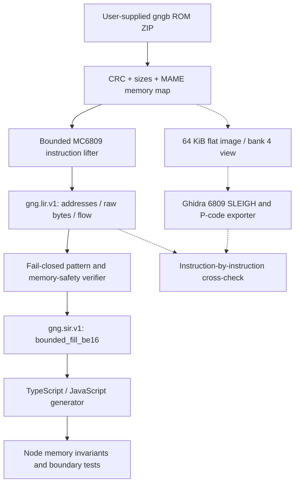

# Architecture and proof boundary

## Scope

This proof demonstrates one real ROM routine at reset `0x6002–0x6013`. The 6809 reset
entry is `0x6000`, where `ORCC #$50` precedes this loop. The bounded
routine sets `X=0x1e00`, `Y=0x0060`, `D=0xf8f8`; executes two big-endian
16-bit post-increment stores per iteration; decrements `Y` and loops while
nonzero. Result: `0x1e00..0x1f7f` each becomes `0xf8` (384 bytes). This
matches the sprite RAM window `0x1e00..0x1fff` in MAME.

**This is actual ROM-lifted 6809 code, not a synthetic demo** when run with the
compatible `gng.zip`. It is **not yet game physics, sprite rendering, a general
6809 translator or complete decompilation**. The generated function does not
interpret 6809 opcodes at runtime; it is ordinary JS/TS using a typed array.

## Determinism and authenticity

- ROM provenance: check byte length and CRC for `gg3.bin`, `gg4.bin`, `gg5.bin`; check reset vector `0x6000`.
- Source provenance: preserve source-address array, raw bytes and SHA-256 of routine window.
- Decoder: seven specified instruction patterns only, rejects others.
- Control flow: branch must go to first store, and the counter must decrement.
- Safety: ensure every access stays within sprite RAM; refuse unsupported paths.
- Ghidra: optional independent decode and P-code extraction, fail on differing instruction bytes, boundaries or absent P-code.
- Runtime: assert touched range and untouched guards in Node; no MAME dependency or gameplay recording.

## Bank awareness

A flat `gngb-flat.bin` represents **one** address-space view: ROM bank 4 in
`0x4000..0x5fff`, fixed `gg4.bin` remainder in `0x6000..0x7fff`, fixed
`gg3.bin` in `0x8000..0xffff`. Banks 0–3 are four `0x2000` pages in `gg5.bin`.
They appear in `rom-map.json` but are **not lifted** by this first experiment.
Writing to `0x3e00` selects a page at runtime. Future IR must represent
bank contexts explicitly, not flatten them into falsely unique addresses.

## Next proving gates

1. Extract multiple finite subroutines with branch/control flow, not only this initialization loop.
2. Generalize P-code ingestion (treat Ghidra as the decoder) and implement typed SSA-ish LIR, address-space overlays and contract checks.
3. Add a TypeScript game-core package with deterministic ticks and extracted graphics; RN renderer stays downstream.
4. For semantic claims (physics/collision), require explicit evidence and unit tests; a human can compare gameplay, but no headless MAME recording gate.

## Attribution and licensing

This project contains no ROMs, sprites or extracted binary blobs. Use ROMs
only where you have appropriate rights. MAME's driver is used as a description
of the original machine memory layout; this POC does not vendor its source.