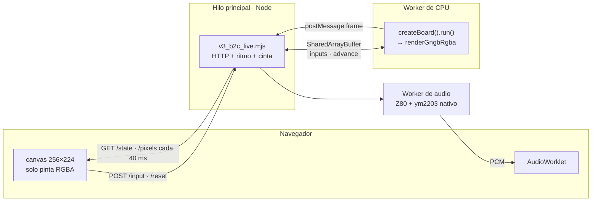
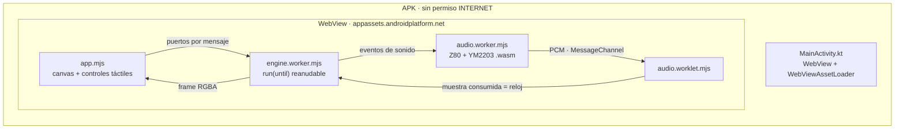

# Arquitectura de la base: detalle técnico

Complemento del [README](../README.md). Aquí están las tablas y los detalles internos que el README resume.

## Componentes

| Capa | Archivos | Responsabilidad |
|---|---|---|
| Compilación 6809 | [mc6809_aot.mjs](../src/mc6809_aot.mjs), [mc6809_aot_lib.mjs](../src/mc6809_aot_lib.mjs) | Descubre bloques y genera JS, con ALU y máscaras de valores conocidos |
| Descubrimiento | [v3_b3_static_closure.mjs](../src/v3_b3_static_closure.mjs), [v3_b3_jump_tables.mjs](../src/v3_b3_jump_tables.mjs), [v3_b3_ondemand.mjs](../src/v3_b3_ondemand.mjs) | Cierre estático de la ROM, tablas de salto y semillas desde cintas |
| Congelado | [v2_b1_frozen.mjs](../src/v2_b1_frozen.mjs) | Bundle inmutable con hashes y rechazo de corrupción |
| Placa | [gngb_runtime.mjs](../src/gngb_runtime.mjs), [gngb_block_key.mjs](../src/gngb_block_key.mjs) | Mapa `gng_main_map`, bancos, IRQ de VBLANK, DMA de sprites, latch y snapshots |
| Video | [gngb_frame_renderer.mjs](../src/gngb_frame_renderer.mjs), [video_memory.mjs](../src/video_memory.mjs), [sprite_memory.mjs](../src/sprite_memory.mjs) | Compone FG, BG y sprites con prioridad y genera RGBA de 256×224 |
| Sonido | [gngb_z80_live_session.mjs](../src/gngb_z80_live_session.mjs), [gngb_z80_sound_bus.mjs](../src/gngb_z80_sound_bus.mjs), [ao_ym2203_wasm.cpp](../src/ao_ym2203_wasm.cpp) | Un Z80 compilado ejecuta `gg2.bin` y dos YM2203 (ymfm) producen PCM |
| Transporte de audio | [gngb_audio_resampler.mjs](../src/gngb_audio_resampler.mjs), [gngb_audio_pcm_queue.mjs](../src/gngb_audio_pcm_queue.mjs) | Cola PCM y remuestreo a la frecuencia de la tarjeta de sonido |
| Entradas | [gngb_input_contract.mjs](../src/gngb_input_contract.mjs) | Acciones del jugador traducidas a bits activos en bajo en `0x3000–0x3002` |

## Mapa de memoria de la placa

`gngb_runtime.mjs` reproduce el `gng_main_map` de MAME 0.289:

| Dirección | Qué es |
|---|---|
| `0x0000–0x1DFF` | RAM de trabajo (lo que nunca se escribió es desconocido) |
| `0x1E00–0x1FFF` | Sprite RAM, 128 × 4 bytes |
| `0x2000–0x27FF` / `0x2800–0x2FFF` | VRAM FG (tiles 8×8) / VRAM BG (tiles 16×16) |
| `0x3000–0x3004` | Entradas activas en bajo; DIP fijos en `0xDF` y `0xFB` |
| `0x3800–0x39FF` | Paleta RGBx_444 |
| `0x3A00` | Sound latch hacia el Z80 |
| `0x3B08–0x3B0B` | Scroll del BG |
| `0x3C00` | Escribir aquí copia la sprite RAM al buffer del renderer (DMA) |
| `0x3D00–0x3D07` | Latch LS259 (flip) |
| `0x3E00` | Selector de banco |
| `0x4000–0x5FFF` | ROM con banco (5 bancos de 8 KiB) |
| `0x6000–0xFFFF` | ROM fija y vectores |

Cada frame dura 25.152 ciclos a 1,5 MHz (16,768 ms). La IRQ de VBLANK entra una vez por frame y queda retenida hasta el ACK. La fase en curso vive en `0x0072`, la vuelta en `0x0071` y el checkpoint en `0x0081`.

## Generaciones del bundle

| Generación | Cómo se amplió | Tamaño | Qué desbloqueó |
|---|---|---|---|
| R3.5 T5 | Bucle `UNCOMPILED` → semilla, 32 iteraciones | 354 bloques | 600 frames continuos desde reset |
| V3.B2B | Cintas de Coin, Start y controles | 663 bloques | Primeros efectos de input |
| V3.B2D | Rutas tardías de Coin y Start | 1.654 bloques | 3 perfiles de 1.500 frames |
| B3 g1–g2 | Descubrimiento de una pasada desde cintas | 2.266 bloques | Crédito, Start y Arthur controlable |
| B3 g3 | Bloques multi-entrada (el IRQ vuelve a mitad de bloque) | 8.287 entradas | 24.000 frames en vivo |
| B3 g4 | 241 tablas de salto estáticas | — | Sesiones largas del bot sin HALT |
| B3 g5 | Cierre estático de toda la ROM | 37.977 entradas | 5 de 5 HALT históricos cubiertos |
| **B3 g6 (vigente)** | El cierre salta punteros nulos en tablas | 38.084 entradas · 27 MB | Las 7 fases cargan y corren igual que MAME |

Ninguna generación modifica a la anterior.

## Motor web por dentro

> **31/10/2026:** el escritorio de producto usa la misma app que Android (`node scripts/ao_serve.mjs`): el motor corre en un worker del navegador sobre los hosts de la base. El servidor descrito aquí queda como laboratorio del bot (`bot/record-gameplay.mjs`, `bot/practice-water.mjs`).



- Tras cada frame la CPU espera en `Atomics.wait` hasta que el hilo principal la libera, al menos 17 ms después: la emulación avanza a ~60 Hz. La página refresca la imagen cada 40 ms (25 fps).
- `/state` incluye `busWitness`: las lecturas que la CPU hizo de verdad en `0x3000–0x3001`, con ciclo y PC.
- Cada sesión graba una cinta de puertos en `out/v3/b3/live-tapes`; [v3_b3_live_replay.mjs](../scripts/v3_b3_live_replay.mjs) la reproduce offline con el mismo hash de frame.
- Moneda usa pulsos de 100 ms: la ROM solo acredita si la CPU la lee activa en 12 frames o menos ([df13b38](https://github.com/krukmat/gng-ghidra/commit/df13b38)).

## App Android por dentro



| Tema | Web | Android |
|---|---|---|
| Host | Node + navegador | Shell Kotlin con WebView, todo local |
| Ritmo de la CPU | `Atomics.wait` sobre `SharedArrayBuffer` | `run(until)` reanudable por frame; una WebView sin aislamiento de origen no garantiza `SharedArrayBuffer` |
| YM2203 | Proceso nativo (ymfm) | ymfm en un `.wasm` de 32 KB, PCM idéntico byte a byte al nativo |
| Reloj maestro | Temporizador del hilo principal | La muestra de audio ya consumida por el altavoz, con 8 frames (134 ms) de adelanto |
| Corte de audio (underrun) | Detiene el audio | Con sonido ON abre una sesión nueva, máximo 5 por minuto |
| Imagen | Refresco cada 40 ms | Hasta 60 fps; baja a 30 si el teléfono no llega |

[ao_resumable_runtime.mjs](../src/ao_resumable_runtime.mjs) deriva el runtime reanudable sin tocar el certificado. Se probó con 600 llamadas `run(k)` contra un solo `run()`: hashes de frame, eventos de audio y ciclo final idénticos.

### Verificaciones (Playwright, headless)

| Comando | Qué comprueba |
|---|---|
| `node scripts/ao_browser_check.mjs` | Motor en Chromium: 600 frames RGBA idénticos a Node; 120 s a ritmo real |
| `node scripts/ao_controls_check.mjs` | Cada toque llega a una lectura real de la CPU; `--gameover` prueba Game Over + Continuar |
| `node scripts/ao_stick_android_check.mjs` | Joystick en el emulador con toques reales del sistema operativo |
| `node scripts/ao_audio_check.mjs` | Sonido ON/OFF, segundo plano y reinicio sin cortes |
| `node scripts/ao_android_check.mjs 600 <serial> --audio` | Medida en el teléfono por ADB (pendiente) |

## Contratos entre capas de la futura base

| Contrato | Qué fija |
|---|---|
| Binario → regiones | Revisión, tamaños y hashes; receta de disposición explícita |
| Compilador → vista de código | Bytes e identidad del código por contexto, sin conocer puertos ni bancos del juego |
| CPU ↔ placa | Lecturas y escrituras con tiempo y máscaras conocidas; las interrupciones vienen de la placa |
| Ejecución → host | Crear sesión, avanzar hasta un límite, recibir el estado de parada; reset de CPU, de placa y sesión nueva son distintos |
| Placa → video / sonido | Frame con geometría y secuencia; PCM con frecuencia, posición de muestra y sesión |
| Usuario → juego → placa | Acciones lógicas traducidas a hardware; DIP y secuencias especiales fuera del host común |
| Oráculo → comparador | Evidencia atada a binario, herramientas, escenario y ámbito; un PASS no se transfiere sin validar |

Estructura propuesta de un proyecto generado:

```text
proyecto-nuevo/
  base/                  copia versionada de componentes de la base
  boards/<placa>/        bus, mapas, bancos, dispositivos y señales
  games/<juego>/         revisión ROM, receta, controles y observadores
  tools/  tests/
  android/               opcional, generado desde la plantilla
  roms/  out/            privados, ignorados por Git
  migration.json         selección y configuración
  migration.lock.json    revisión exacta y hashes de la base
```
