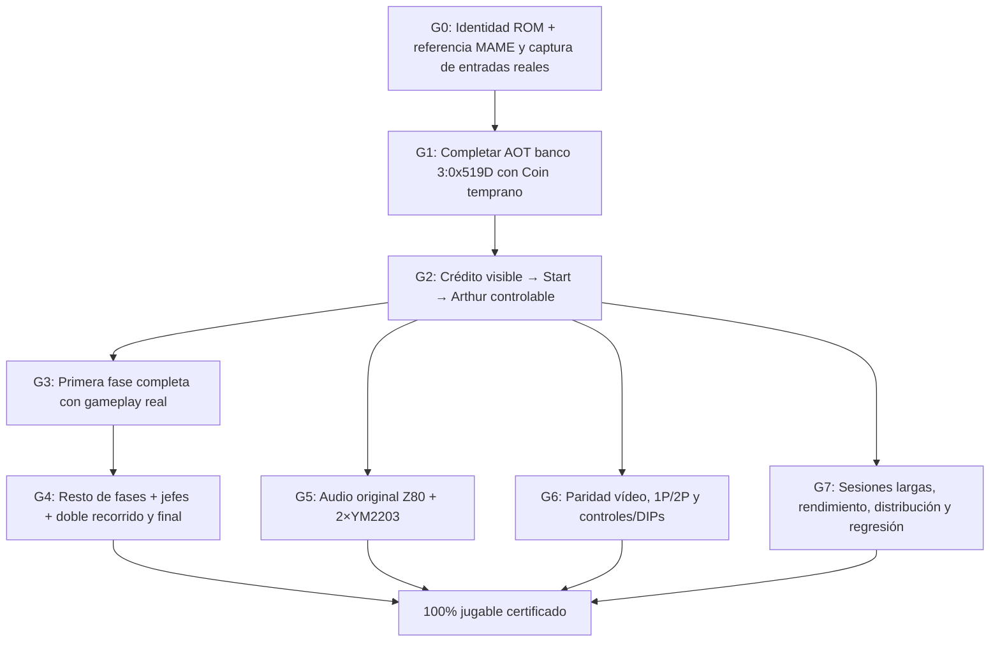

# Plan de ejecución hacia GnG 100% jugable — V3→V4

**Puerta de entrada para modelos sucesores:** [ENTRYPOINT — 100% jugable](agents/gng-100-playable-entrypoint.md). Este plan es sugerido y modificable; el objetivo funcional 100% no lo es.

**Fecha:** 2026-10-26 · **Rama de trabajo:** main · **Estado:** planificación de dependencias, **NO** certificación de jugabilidad.
**Prioridad:** funcionalidad real antes de cobertura AOT extensa; CPU del arcade original recompilada fuera de runtime; ROM privada solo en Mac.

## 0. Definición de DONE — 100% jugable

Una versión **100% jugable** significa que el usuario puede arrancar la placa original reproducida, insertar créditos, iniciar 1P/2P conforme a su comportamiento arcade, controlar a Arthur, superar todas las fases, enemigos y jefes, pasar por ambos recorridos requeridos por el juego y ver el desenlace auténtico. Incluye vidas, muerte, respawn, continuidad/game over, puntuación, armas, armadura, físicas/colisiones, scroll, sprites, audio/música, y sesiones prolongadas a cadencia estable sin bloqueos AOT. No equivale a haber compilado un número arbitrario de bloques ni a que una diferencia de hash demuestre movimiento.

**Invariantes no negociables:**
- **Motor auténtico:** código MC6809 de la revisión ROM elegida recompilado AOT, ejecutado desde reset. Nunca interpretar opcodes en runtime, inyectar estados, manipular sprites para representar acciones ni usar vídeo pregrabado o MAME de motor.
- **Oráculo independiente:** MAME solo para referencia/capturas de laboratorio. Misma ROM/revisión, DIPs, reloj, reset y cronología de inputs; no comparar grabaciones incompatibles.
- **Evidencia por niveles:** entrada leída ≠ crédito registrado ≠ partida iniciada ≠ avatar controlable ≠ nivel completado ≠ juego terminado.
- **AOT privado versionado:** B2-D (1654 bloques) permanece intacto. Nuevos artefactos en un directorio propio ignorado por git, con hash del código, fuentes, inputs y reportes. Ningún fallback silencioso.
- **No declarar 100% hasta superar todos los gates de la matriz.** Los porcentajes anteriores correspondían a hitos parciales, no a cobertura de juego completa.

## 1. Baseline acreditado y bloqueo vigente

| Área | Evidencia observada | Límite |
| --- | --- | --- |
| CPU MC6809 AOT, memoria, IRQ y vídeo | V2: 600 frames, 290 frames pixel-exact (311–600). B2-D: 1654 bloques, 3 perfiles gameplay de 1500 frames | No certifica todas las ramas de un jugador humano |
| Render en navegador | RGBA auténtico desde frame 311; no negro; DOM/transport corregido | Falta comparar pantallas de partida/scroll/sprites reales |
| Interacción | Coin1 22 lecturas activas y Start1 17, pausa de CPU en VBlank real y reanudación correcta | Todavía no hay crédito/pantalla de juego acreditados |
| Bloqueo que manda sobre todo lo demás | Con Coin temprano tras pausa en frame 311, HALT frame 496, **bank=3, PC=0x519D** | Ramas de B2-D no cubren esta cronología |
| Camino secundario idle | En B2-D, HALT frame 1038, fixed PC 0x6A9D; B2-E preparado | **No está en la ruta crítica de primera jugabilidad** |
| Audio | Runtime principal registra `soundlatch` y driver MAME especifica CPU Z80 + 2 YM2203 | No se ha implementado/certificado el subsistema sonoro |

Fuente de hardware: `https://github.com/mamedev/mame/blob/master/src/mame/capcom/gng.cpp`. La implementación debe fijar la revisión de ROM realmente empleada (**gngb** frente a **gng**) y el MAME de referencia antes de acreditar equivalencia.

## 2. Dependencias obligatorias, no orden cronológico arbitrario

**Ruta crítica inmediata:** G0 → G1 → G2 → G3. El modo attract extendido B2-E y cualquier nuevo visor quedan fuera de ella salvo que bloqueen una prueba necesaria. **Ruta al 100%:** todas las ramas G4/G5/G6/G7 deben cerrar.

## 3. Backlog ejecutable con dependencias y criterios STOP/GO

### G0 — Captura y reproducción fiel de la interacción real (P0)

**Depende de:** B2-D ya certificado y runner B2-C con pausa VBlank (PASS de infraestructura).

- **G0.1:** registrar en el motor activo las transiciones HUMANAS Coin/Start/P1/P2 con ciclo CPU absoluto y frame de aplicación, sin registrar ROM/RAM privadas en Git. Incluir tiempo de pausa/reanudación; confirmar las lecturas verdaderas de bus `0x3000/0x3001`.
- **G0.2:** generar una *input tape* reproducible de la secuencia que falló: Coin desde frame 311, Start observado cerca de frame 481, HALT banco 3/0x519D en 496. Distinguir tiempo de evento externo de lectura de CPU; no inventar la duración de una tecla a partir del contador de lecturas.
- **G0.3:** ejecutar referencia MAME de la misma revisión/inputs y capturar testigos de crédito, Start, RAM relevante, render, PC/banco. Reutilizar `scripts/r0-blackbox-*` y capturadores nativos **solo si** pueden producir la misma cronología; de lo contrario crear harness de control mínimo compatible.

**GO G0:** tape privado versionado + hash; replay reproduce HALT (bank 3, PC 0x519D) o equivalente previo exacto. **STOP:** una cronología distinta o falta de evidencia de entrada.

### G1 — AOT de ruta de crédito/Start tempranos (P0)

**Depende de:** G0.

- **G1.1:** crear nuevo paquete privado descendiente de B2-D (no modificar B2-D/B2-E). Sembrar banco 3, PC 0x519D y posteriores `UNCOMPILED` mediante compilación offline incremental, con checkpoint/reanudación y límite por tanda; jamás durante render o juego vivo.
- **G1.2:** repetir desde reset la tape real G0 después de cada expansión hasta cubrir crédito y Start; verificar que los perfiles B2-D previos no cambian (estado, hashes de frame, lecturas CPU).
- **G1.3:** congelar/promocionar el paquete solo tras contrato de integridad, replay determinista y un efecto funcional **visible/corroborado**, no simplemente `FRAMES_DONE`. Mantener el bundle previo seleccionable ante error.

**GO G1:** se recorre la ruta de input temprano más allá de 496, sin rutas ausentes durante el inicio de juego. **STOP:** mismatch nativo, salto a dirección ROM/RAM inexplicable, datos privados faltantes o divergencia de baseline.

### G2 — Primera partida realmente controlable (P0)

**Depende de:** G1 y render auténtico (actualmente disponible).

- **G2.1:** demostrar secuencia visual: crédito aumenta → Start consume crédito/entra al juego → Arthur aparece en escena real. Anexar evidencia de MAME sincronizada; leer contador/estado solo como corroboración, no sustituir visual.
- **G2.2:** flechas izquierda/derecha/arriba/abajo, botón de ataque y salto alteran el personaje/colisiones **por el código original**; probar pulsar/soltar, múltiples duraciones, combinaciones válidas y edge cases. Comprobar hardware P1 4-way, sin codificar animaciones manuales.
- **G2.3:** interacción sostenida durante **al menos cinco minutos** con movimiento, ataque, salto y no fatal por bloque AOT. Si aparece otro PC, volver a G1 con esa tape exacta.

**GO G2 = PRIMERA BUILD JUGABLE:** moneda visible, Start real, Arthur controlable y reproducción desde reset. No llamarla 100% todavía.

### G3 — Primera fase jugable de inicio a fin (P0/P1)

**Depende de:** G2.

- **G3.1:** completar cobertura CPU/bancos/RAM overlay en el recorrido de la primera fase (bot real nativo o sesiones humanas registradas), incluyendo enemigos, spawn, colisiones, armadura, vida, muerte/respawn, disparos, objetos y scroll.
- **G3.2:** certificar progreso, derrota y transición de la fase mediante eventos reales, referencia MAME y frames de puntos clave; matriz de caminos ganadores/perdedores, no un único run feliz.

**GO G3:** primera fase completada y una derrota/respawn observados sin pérdida de control, falsos pixels ni `UNCOMPILED`.

### G4 — Cobertura funcional íntegra del juego (P1)

**Depende de:** G3. Progreso incremental por fase, no expansión ciega de attract.

- **G4.1:** una matriz por fase y jefe; completar transiciones, enemigos, armas, puntuación, vidas, game over y nuevos créditos. Para rutas raras, capturar input tape nueva y ampliar AOT a partir del error observado.
- **G4.2:** recorrer **primera y segunda vuelta** requeridas por el arcade y llegar al final auténtico, sin cambiar reglas ni usar `stage select` como demostración de final. Usar automatización nativa con trazas veraces y aprobación visual en checkpoints.
- **G4.3:** probar ruta alternativa de muerte/no victoria, reinicio/reintento y continuidad, además de partidas sin errores de compilación.

**GO G4:** juego completo y final alcanzables desde reset con controles reales; no basta un bot mostrando un solo nivel.

### G5 — Audio del hardware original (P1, paralelo a G3/G4)

**Depende de:** G2 para tener eventos de juego útiles; investigación de driver ya disponible.

- **G5.1:** contrato MainCPU→soundlatch→CPU Z80 (ROM privada de audio), sincronización, IRQ/reset y dos registros de **YM2203**. Elegir explícitamente núcleo exacto de Z80/síntesis o recompilación de audio; no reproducir MP3 ni pistas tomadas de MAME como banda sonora del producto.
- **G5.2:** generar audio real sincronizado con el juego y comprobar música, disparos, daño/muerte y transiciones contra referencia nativa. Mezcla mono y latencia comprobables; probar sin audio como fallo visible/no silencioso.

**GO G5:** sonido original generado durante juego real, sin ROM/archivos musicales embebidos ilícitamente.

### G6 — Integridad visual y controles completos (P1, paralelo a G3/G4)

**Depende de:** G2 para escenas de juego y G0 para un oráculo fiable.

- **G6.1:** capturar paridad frame/snapshot en título, juego, scroll, sprites DMA, paleta, prioridades, flip, muerte, transición de fase y boss. No extrapolar los 290 frames pixel-exact de V2 a escenas nuevas; cualquier divergencia se clasifica/soluciona.
- **G6.2:** verificar START2/P2, modalidad de turnos original, créditos, servicio y DIP usados por el juego; teclado/gamepad si se decide dar soporte. El runtime actual solo instrumenta P1 en la UI: no dar por probada funcionalidad de 2P.

**GO G6:** comportamiento visible y controles de todos los modos de usuario previstos, con paridad nativa para escenarios representativos y sin discrepancias críticas abiertas.

### G7 — Robustez, rendimiento y entrega de producto (P1)

**Depende de:** G2 para medir sesiones auténticas; cierre final después de G4–G6.

- **G7.1:** reemplazar límite de sesión demo `6000` y retención indefinida de `state.records` con salida de frames por streaming/buffer acotado y control de backpressure. No tocar semántica CPU. Sincronizar a cadencia nativa (hardware ~59,64 Hz) y medir CPU, RAM, latencia input/vídeo/audio, reinicio y foco del navegador.
- **G7.2:** empaquetar una build reproducible con carga **local y validada** de ROM privada; errores claros por ROM/revisión faltante; sin descargas encubiertas, MAME embebido ni datos derivados de ROM en repositorio.
- **G7.3:** ejecutar suite ROM-free + gates privados + sesiones largas, dos recorridos, regresiones de sonido/vídeo y revisión manual. Mantener hashes/artefactos de evidencia privados con reporte público solo de marcadores no sensibles.

**GO G7:** una partida completa no termina artificialmente por límites del harness, fugas de memoria o problemas de navegador; build reproducible y estable.

## 4. Definición verificable de hitos

| Checkpoint | Condición mínima | Estado actual |
| --- | --- | --- |
| **H0: motor real** | AOT + render + puertos | PASS (B2-C/B2-D, parcial vídeo) |
| **H1: crédito + Start** | Créditos y cambio visual de pantalla, comparados con MAME | **GO (V3.B3)**: idéntico byte a byte a MAME 0.288 |
| **H2: primer prototipo jugable** | Arthur controlable + 5 min + no `UNCOMPILED` | **PARCIAL**: Arthur controlable; 6,4 min de juego por bot idénticos a MAME offline; en vivo, HALT `0xFEFA` en el frame 1.974 (timing) → G1.4 |
| **H3: primer nivel completo** | G3 GO + derrota/respawn | PENDIENTE |
| **H4: contenido completo** | G4 GO, ambas vueltas, final verdadero | PENDIENTE |
| **H5: paridad audiovisual** | G5 y G6 GO | PENDIENTE |
| **H6: 100% jugable** | G4 + G5 + G6 + G7 **todos GO** | PENDIENTE |

No asignar progreso global por número de bloques: el porcentaje solo puede derivarse de pruebas funcionales ponderadas después de H2. Un bundle de 1654 bloques no indica 1654/n bloques de juego.

## 5. Política de ejecución y reducción de iteraciones

1. **Una sola ruta crítica en curso:** G0→G1→G2 hasta H2; G3 después. G5, G6 y G7 se abren en paralelo solo cuando tengan inputs reales. **No iniciar B2-E extendido como prerrequisito de H1**.
2. **Automatizar descubrimiento de ramas desde tapes humanas o bot nativo** con reporte `profile,bank,pc,overlay,frame,cycle,sha256`, compilación offline, restart reproducible, checkpoint; no esperar a 96 iteraciones si ya hay un efecto visual temprano verificable.
3. **Evitar falso progreso:** `BUS_COIN1`, `BUS_START1` y `FIRST_CONTROLS_EFFECT` son señales diagnósticas. Los gates H1–H6 requieren semántica de juego y evidencia visual.
4. **Local Mac solo cuando haga falta ROM/MAME real**; implementación, review de fuentes, tests sintéticos y documentación en `main` por GitHub. Usar exactamente los outputs locales como fuente de confianza; nunca afirmar que pruebas privadas corrieron en la nube.
5. **STOP/rollback:** cualquier incompatibilidad retrocede al último paquete congelado PASS sin editarlo; reporte del bloqueo concreto, siguiente target y comandos mínimos.

## 6. Siguiente bloque seleccionado y tareas concretas

> **Actualización 26/10/2026:** G0.1/G0.2/G1 cerrados por V3.B3 ([informe](v3-b3-playable-2026-10-26.md)). G0.3 (MAME) GO. **Nuevo bloqueo:** en vivo, el timing real abre rutas indirectas no compiladas (`0xFEFA`). Siguiente: **G1.4, cobertura robusta** (grabador de puertos en vivo, fuzzing con jitter, recuperación estática de saltos indirectos) antes de la sesión humana (G2.3) y de G3.

**Bloque inmediato G0+G1 — No crear otro visor ni ampliar attract a ciegas.**

| Task | Dependencia | Resultado exigido |
| --- | --- | --- |
| G0.1 Capturar los eventos humanos (Coin desde VBlank 311 y Start) en ciclos CPU | B2-C | `input-tape.json` privado y reproducible |
| G0.2 Construir runner de paridad y referencia MAME con esa misma tape | G0.1 | crédito/Start contrastables |
| G1.1 Sembrar **bank=3, PC=0x519D** sobre nuevo hijo de B2-D | G0.1 | próxima ruta AOT compilada offline |
| G1.2 Expandir estrictamente rutas de esta tape hasta salir del frame 496 | G1.1 | evidencia de progreso y sin `UNCOMPILED` en esta ventana |
| G1.3 Verificar B2-D anterior y publicar bundle privado solo tras parity | G1.2 | regresiones previas PASS; candidato íntegro |
| G2.1 Validar crédito/Start/Arthur con el motor navegador | G0.2, G1.3 | **H1 GO**, base de primera jugabilidad |

**Primer entregable de valor:** créditos y Start funcionando en el juego original real, no otro informe de AOT. Después priorizar G2.2 (movimiento/salto/ataque) antes de expandir niveles o audio.
